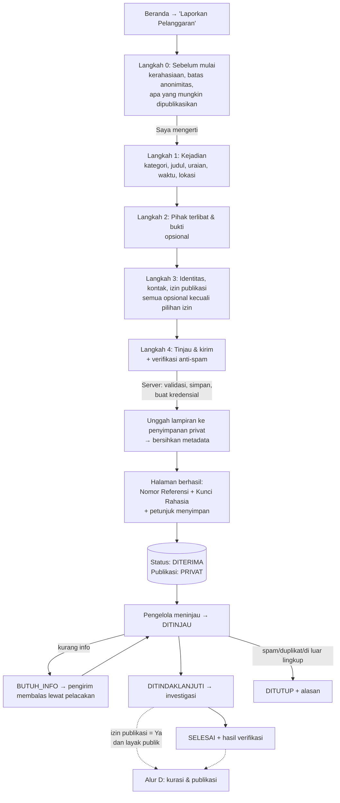
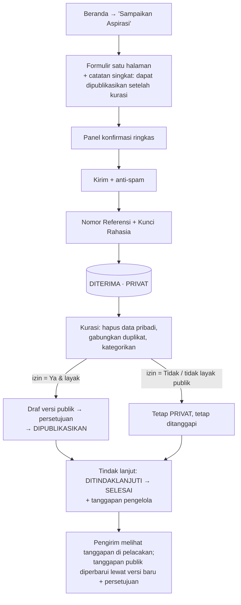
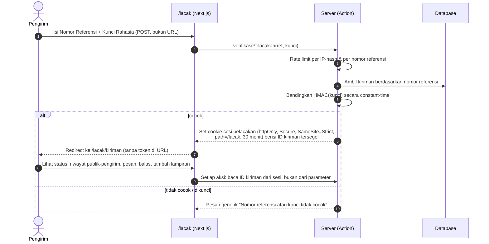
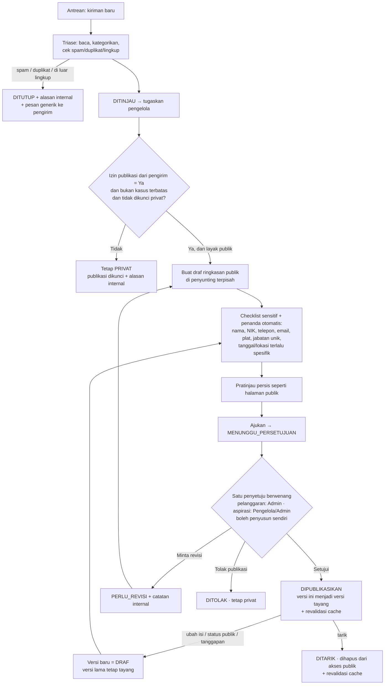
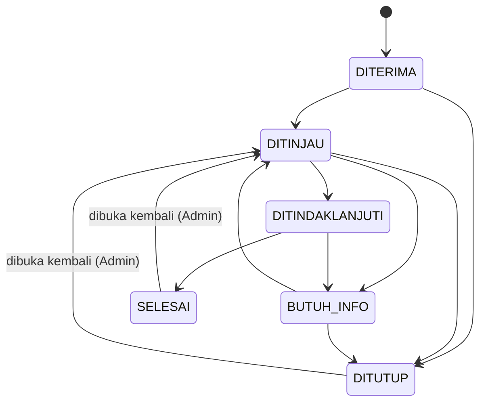
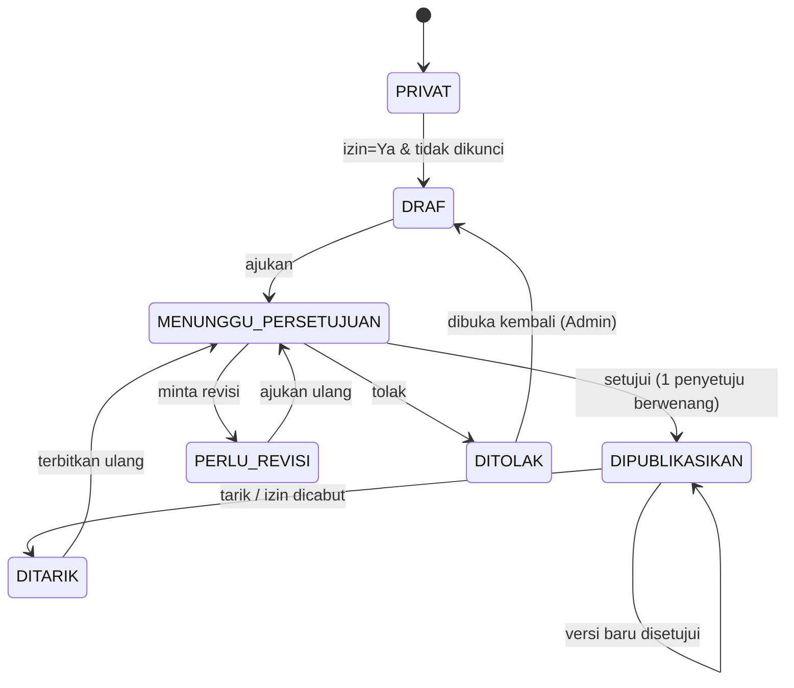

# 01 — Konsep, Ruang Lingkup, Peran, Alur, dan Status

> Bagian dari rencana pembangunan **Whistleblowing System & Penampung Aspirasi** (nama kerja: *Lapor Pak*).
> Mencakup hasil perencanaan no. 1–5. Asumsi bertanda **[A#]** dijelaskan di [README](README.md#asumsi).

---

## 1. Ringkasan konsep dan tujuan aplikasi

### 1.1 Konsep

Satu website untuk satu organisasi **[A1]** dengan dua layanan:

| Layanan | Untuk apa | Sifat default | Yang mungkin tampil di publik |
|---|---|---|---|
| **Laporkan Pelanggaran** | Dugaan pelanggaran: kronologi, pihak terlibat, bukti | **Rahasia** | Hanya *ringkasan yang ditulis ulang dan disamarkan* oleh pengelola, dan hanya jika pengirim mengizinkan serta pengelola menyetujui |
| **Sampaikan Aspirasi** | Ide, saran, kritik, usulan perbaikan | Privat sampai dikurasi | Versi aspirasi yang sudah dibersihkan dari data pribadi beserta tanggapan pengelola, jika pengirim mengizinkan |

Pengirim **tidak perlu akun**. Setelah mengirim, pengirim menerima **Nomor Referensi** dan **Kunci Rahasia**. Keduanya dipakai bersama untuk melacak status dan membalas pertanyaan pengelola.
Pengelola dan admin login ke dashboard dengan **autentikasi dua faktor**.

**Keputusan kebijakan (10 Okt 2026):**

- Ringkasan whistleblowing **dipublikasikan** dalam bentuk tersamar, dengan izin pengirim.
- Setiap publikasi cukup disetujui oleh **satu orang** yang berwenang, dan orang itu boleh penyusun ringkasannya sendiri.

### 1.2 Tujuan

1. **Saluran aman:** orang berani melapor karena identitas dan bukti dilindungi sejak rancangan.
2. **Saluran aspirasi:** ide dan kritik tertampung dengan rapi, lalu ditanggapi.
3. **Transparansi terkurasi:** publik melihat bahwa kiriman ditangani, tanpa membuka data sensitif dan tanpa “mengadili” pihak mana pun.
4. **Akuntabilitas internal:** setiap akses dan keputusan tercatat di audit log.

### 1.3 Prinsip rancangan (berlaku di semua bagian rencana)

| # | Prinsip | Konsekuensi konkret |
|---|---|---|
| P1 | **Privat secara default** | Kiriman baru tidak punya representasi publik sama sekali. Konten publik adalah entitas terpisah yang harus dibuat dan disetujui. |
| P2 | **Publikasi ≠ verifikasi** | Status publikasi, status penanganan, dan hasil verifikasi adalah tiga kolom terpisah. Halaman publik selalu menampilkan penafian “belum tentu terbukti” untuk ringkasan pelanggaran. |
| P3 | **Yang tampil hanyalah versi yang disetujui** | Konten publik memakai sistem versi. Setiap perubahan membuat versi baru yang harus disetujui ulang. Versi lama tetap tayang sampai versi baru disetujui. |
| P4 | **Persetujuan eksplisit oleh satu orang berwenang** | Setiap versi publik wajib disetujui oleh **satu** petugas dengan peran yang sesuai. Ringkasan pelanggaran hanya boleh disetujui Admin, sedangkan aspirasi boleh disetujui Pengelola atau Admin. Penyusun **boleh** menyetujui versinya sendiri, asalkan checklist lengkap, pratinjau sudah dibuka, dan setiap penanda data pribadi sudah dikonfirmasi. |
| P5 | **Data minimal** | Tidak menyimpan IP mentah atau user-agent pengirim. Kontak dan identitas bersifat opsional dan dienkripsi. Metadata lampiran dibersihkan. |
| P6 | **Hak akses diperiksa di server** | Menyembunyikan tombol bukan bentuk kontrol akses. Setiap operasi privat memeriksa sesi, peran, dan izin kasus di server. |
| P7 | **Jujur soal anonimitas** | Tidak pernah menjanjikan “100% anonim”. Batasannya dijelaskan sebelum pengguna mulai mengisi. |

### 1.4 Indikator keberhasilan (usulan, dikonfirmasi)

- ≥ 90% kiriman baru ditriase dalam **3 hari kerja** **[A7]**.
- Formulir pelanggaran rata-rata selesai diisi dalam < 10 menit di ponsel (diuji pada uji kegunaan).
- 0 insiden konten privat muncul di publik (diuji otomatis di setiap rilis).
- ≥ 50% permintaan informasi tambahan dibalas pengirim (ukuran kepercayaan pada kanal pelacakan).

---

## 2. Ruang lingkup MVP dan fitur lanjutan

### 2.1 Tabel ruang lingkup

| Area | MVP (rilis pertama) | Lanjutan (setelah MVP dievaluasi) |
|---|---|---|
| Beranda & informasi | Beranda dengan 2 layanan, panduan, kerahasiaan, FAQ, kontak, kebijakan privasi | Halaman statistik publik agregat, laporan tahunan |
| Formulir pelanggaran | Formulir bertahap, lampiran gambar/PDF, identitas & kontak opsional, izin publikasi | Lampiran video/audio, dokumen Office, rekaman suara |
| Formulir aspirasi | Formulir satu halaman + konfirmasi | Template aspirasi per topik, kampanye aspirasi bertema |
| Pelacakan | Nomor referensi + kunci rahasia, status, pesan dua arah, tambah lampiran, tarik izin publikasi | Ganti kunci rahasia, permintaan penghapusan data oleh pengirim |
| Notifikasi | Email opsional **tanpa isi kiriman** (hanya “ada pembaruan”) — jika disetujui (Q4) | Notifikasi push, webhook ke sistem internal |
| Publikasi | Daftar & detail aspirasi, daftar & detail ringkasan pelanggaran, pencarian, filter kategori & status publik | Komentar publik, voting/dukungan, berbagi ke media sosial, RSS |
| Dashboard | Antrean, detail, catatan internal, penugasan, pesan, penyunting ringkasan, pratinjau, persetujuan, penarikan, riwayat, audit, akun, kategori, statistik agregat | SLA otomatis & eskalasi, laporan PDF, label/tag kustom, pencarian teks penuh lanjutan, peninjauan pasca-publikasi oleh orang kedua (opsional) |
| Keamanan | Lihat [03 §9](03-arsitektur-data-keamanan.md#9-keamanan-dan-pencegahan-penyalahgunaan) — kontrol bertanda MVP | Pemindaian antivirus terkelola, enkripsi penuh isi laporan, akses via Tor/onion |
| Lain-lain | Bahasa Indonesia, ramah ponsel, mode terang | Multi-bahasa, mode gelap, multi-organisasi, aplikasi native |

### 2.2 Di luar lingkup secara eksplisit

- **Komentar publik, voting, dan fitur sosial.** Fitur ini dievaluasi setelah MVP karena membutuhkan moderasi tambahan dan berisiko memicu penghakiman publik atas ringkasan pelanggaran.
- **Kurasi otomatis oleh AI.** Isi laporan tidak dikirim ke layanan AI pihak ketiga. Bantuan deteksi data pribadi di MVP berjalan lokal dengan pola sederhana (lihat komponen penyunting di [02 §10.3](02-desain-ux-formulir.md#103-tabel-kebutuhan-komponen)).
- **Layanan darurat.** Situs ini bukan kanal darurat. Beranda dan formulir menampilkan kontak darurat untuk situasi yang mengancam keselamatan.

---

## 3. Tabel peran dan hak akses

### 3.1 Definisi peran

| Peran | Siapa | Cara masuk |
|---|---|---|
| **Pengunjung publik** | Siapa saja | Tanpa login |
| **Pengirim** | Orang yang mengirim laporan atau aspirasi | Tanpa akun. Untuk pelacakan: Nomor Referensi + Kunci Rahasia → sesi pelacakan singkat yang hanya berlaku untuk **satu** kiriman |
| **Kurator/Moderator** | Petugas triase dan penyusun ringkasan publik | Login + 2FA |
| **Pengelola Tindak Lanjut** | Petugas yang menangani atau menginvestigasi kasus | Login + 2FA |
| **Administrator** | Penanggung jawab sistem dan penyetuju ringkasan pelanggaran | Login + 2FA |

### 3.2 Matriks hak akses (model lengkap)

Keterangan: ✅ boleh · ⚠️ terbatas (lihat catatan) · ❌ tidak boleh

| Tindakan | Publik | Pengirim | Kurator | Pengelola TL | Admin |
|---|:-:|:-:|:-:|:-:|:-:|
| Melihat konten publik yang sudah disetujui | ✅ | ✅ | ✅ | ✅ | ✅ |
| Mengirim laporan atau aspirasi | ✅ | ✅ | — | — | — |
| Melihat status, pesan, dan isi kiriman **sendiri** | ❌ | ✅¹ | — | — | — |
| Membaca laporan asli (uraian, kronologi) | ❌ | ✅¹ | ✅ | ⚠️² | ⚠️³ |
| Melihat atau mengunduh bukti/lampiran | ❌ | ⚠️⁴ | ⚠️² | ⚠️² | ⚠️³ |
| Melihat identitas dan kontak pelapor (jika diisi) | ❌ | ✅¹ | ⚠️⁵ | ⚠️⁵ | ⚠️⁵ |
| Menulis catatan internal | ❌ | ❌ | ✅ | ✅ | ✅ |
| Menugaskan kasus | ❌ | ❌ | ✅ | ❌ | ✅ |
| Mengubah status penanganan | ❌ | ❌ | ⚠️⁶ | ✅² | ✅ |
| Menetapkan hasil verifikasi atau tanggapan | ❌ | ❌ | ❌ | ✅² | ✅ |
| Mengirim pesan atau permintaan informasi ke pengirim | ❌ | — | ✅ | ✅² | ✅ |
| Menyusun/mengubah draf ringkasan publik | ❌ | ❌ | ✅ | ✅² | ✅ |
| Mengajukan ringkasan untuk persetujuan | ❌ | ❌ | ✅ | ✅² | ✅ |
| Menyetujui, meminta revisi, atau menolak publikasi **aspirasi** | ❌ | ❌ | ❌ | ✅⁷ | ✅⁷ |
| Menyetujui, meminta revisi, atau menolak publikasi **ringkasan pelanggaran** | ❌ | ❌ | ❌ | ❌ | ✅⁷ |
| Menarik konten dari publik | ❌ | ⚠️⁸ | ❌ | ✅ | ✅ |
| Mengunci kiriman agar tetap privat | ❌ | ⚠️⁸ | ✅ | ✅ | ✅ |
| Menandai spam/duplikat dan menutup | ❌ | ❌ | ✅ | ✅ | ✅ |
| Membatasi akses kasus (kasus terbatas) | ❌ | ❌ | ❌ | ❌ | ✅ |
| Melihat audit log | ❌ | ❌ | ❌ | ⚠️⁹ | ✅ |
| Mengelola akun dan peran | ❌ | ❌ | ❌ | ❌ | ✅ |
| Mengelola kategori, teks halaman, dan pengaturan | ❌ | ❌ | ❌ | ❌ | ✅ |
| Melihat statistik agregat | ⚠️¹⁰ | ❌ | ✅ | ✅ | ✅ |
| Menghapus permanen sesuai retensi | ❌ | ❌ | ❌ | ❌ | ✅¹¹ |

Catatan:

1. Hanya selama sesi pelacakan yang dibuka dengan Nomor Referensi + Kunci Rahasia, dan **hanya untuk kiriman itu**. Pengirim melihat salinan kirimannya, tetapi tidak dapat melihat catatan internal, nama petugas, atau alasan internal.
2. Hanya untuk kasus yang **ditugaskan** kepadanya. Kasus lain hanya terlihat sebagai metadata antrean (nomor, kategori, status, umur).
3. Admin dapat membuka semua kasus **kecuali kasus terbatas** yang tidak mencantumkan dirinya. Setiap pembukaan tercatat di audit log.
4. Pengirim dapat melihat daftar nama generik lampiran yang ia unggah dan menambah lampiran. Pengirim tidak dapat mengunduh ulang lampiran, agar pihak yang meminjam perangkatnya tidak dapat mengambil bukti.
5. Identitas dan kontak **disembunyikan secara default** di layar detail. Tombol “Tampilkan identitas” mewajibkan alasan singkat, lalu tercatat di audit log.
6. Kurator hanya boleh memindahkan status `DITERIMA → DITINJAU`, `DITINJAU → BUTUH_INFO`, dan menutup sebagai spam/duplikat/di luar lingkup.
7. **Satu persetujuan sudah cukup.** Penyetuju **boleh** penyusun atau pengubah terakhir versi itu sendiri, asalkan checklist lengkap, pratinjau sudah dibuka, dan setiap penanda data pribadi sudah dikonfirmasi. Penyetuju, penyusun, dan waktu persetujuan tercatat di audit log.
8. Pengirim dapat **menarik izin publikasi** dari halaman pelacakan. Sistem langsung menarik konten (`DITARIK`) dan mengunci publikasi. Pengirim tidak dapat menerbitkan apa pun.
9. Hanya riwayat tindakan pada kasus yang ditugaskan kepadanya.
10. Hanya angka agregat yang sengaja dipublikasikan (fitur lanjutan), dengan ambang minimum agar tidak ada sel berisi angka kecil (mis. jangan tampilkan angka < 5 per kategori per bulan).
11. Hapus permanen memerlukan konfirmasi ketik ulang nomor referensi dan tercatat di audit log tanpa menyimpan isi kiriman.

### 3.3 Rekomendasi penyederhanaan untuk MVP (tim kecil, 2–5 orang **[A3]**)

**Keputusan yang direkomendasikan: dua peran login.**

| Peran MVP | Menggabungkan | Hak tambahan |
|---|---|---|
| **Pengelola** | Kurator + Pengelola Tindak Lanjut | Membaca semua kasus non-terbatas, menyusun ringkasan, menyetujui publikasi **aspirasi** (termasuk yang disusunnya sendiri) |
| **Admin** | Semua hak Pengelola | Menyetujui **ringkasan pelanggaran** (termasuk yang disusunnya sendiri), mengelola akun dan kategori, membatasi akses kasus, melihat audit penuh, hapus permanen |

Alasan:

- Tim kecil jarang memisahkan petugas triase dan investigator. Pemisahan peran justru dapat menghambat alur.
- Kontrol yang paling penting tetap dijaga oleh aturan, bukan banyaknya peran: **checklist dan pratinjau wajib sebelum persetujuan**, **kasus terbatas**, **identitas tersembunyi + alasan akses**, dan **audit log**.
- Skema data tetap menyimpan `peran` sebagai enum yang dapat diperluas. Peran Kurator dan Pengelola TL bisa dipisahkan nanti tanpa migrasi besar.

Syarat minimum: **≥ 1 Admin aktif**, karena ringkasan pelanggaran hanya dapat disetujui Admin. Disarankan ≥ 2 akun agar ada cadangan saat petugas berhalangan.

**Kontrol pengganti untuk persetujuan satu orang.** Karena tidak ada pemeriksa kedua, risiko identitas bocor lewat ringkasan bergantung pada ketelitian satu orang. MVP menambah tiga pengaman:

1. Tombol **Setujui** baru aktif setelah semua butir checklist dicentang, pratinjau dibuka, dan **setiap penanda data pribadi yang tersisa dikonfirmasi satu per satu** (“bukan data pribadi” atau diperbaiki).
2. Setiap persetujuan tercatat di audit (siapa menyusun, siapa menyetujui, kapan). Admin dapat memfilter persetujuan yang disetujui sendiri oleh penyusunnya.
3. Penarikan dapat dilakukan seketika oleh Pengelola atau Admin (§5.3).

Peninjauan pasca-publikasi oleh orang kedua menjadi fitur lanjutan opsional (§2.1).

**Kasus terbatas:** jika pengirim mencentang “Laporan ini melibatkan pengelola WBS atau pimpinan”, atau admin menandainya, kasus hanya terlihat oleh daftar akses eksplisit. Daftar ini harus memiliki saluran eskalasi independen, misalnya komite etik atau dewan pengawas (lihat pertanyaan Q2).

---

## 4. Alur pengguna dan alur pengelola

### 4.A Pelaporan pelanggaran

Rincian langkah dan perilaku sistem:

| # | Langkah | Perilaku sistem |
|---|---|---|
| 0 | Membaca penjelasan kerahasiaan | Teks singkat + tautan ke panduan lengkap. Tidak ada pelacak, analitik pihak ketiga, atau font eksternal di halaman ini. |
| 1–3 | Mengisi formulir | Validasi di klien untuk kenyamanan dan validasi ulang di server untuk keamanan. Isian **tidak disimpan** di `localStorage`. Peringatan muncul jika pengguna meninggalkan halaman dengan isian belum terkirim. |
| 2 | Menambahkan bukti | Daftar file dipilih di perangkat. Petunjuk jenis dan ukuran file serta peringatan metadata ditampilkan. File baru diunggah setelah teks laporan tersimpan. |
| 4 | Mengirim | Server melakukan verifikasi proof-of-work anti-spam, pembatasan laju, validasi Zod, dan penyimpanan dalam satu transaksi: kiriman, riwayat status awal, dan audit `SUBMISSION_CREATED`. Server membuat Nomor Referensi dan Kunci Rahasia. Hanya hash kunci yang disimpan. |
| 4b | Unggah lampiran | Server memberi URL unggah bertanda tangan yang singkat untuk tiap file ke area karantina. Setelah unggah selesai, server memproses file: cek magic bytes, encode ulang gambar, bersihkan metadata PDF, lalu memindahkannya ke area bukti. Jika sebagian gagal, kredensial **tetap ditampilkan** dengan pesan bahwa lampiran dapat ditambahkan lewat pelacakan. |
| 5 | Halaman berhasil | Kredensial ditampilkan **sekali**, dengan tombol salin, unduh `.txt`, dan centang “Saya sudah menyimpan”. Kredensial tidak dimasukkan ke URL dan halaman ini tidak di-cache. |
| 6+ | Penanganan | Lihat alur pengelola dan tabel status di §5. |

### 4.B Penyampaian aspirasi

Catatan khusus aspirasi:

- Aspirasi yang dipublikasikan **tidak pernah menampilkan nama pengirim** di MVP, meskipun nama diisi.
- Kurator boleh menyunting ejaan dan menghapus data pribadi, tetapi **tidak boleh mengubah makna**. Perubahan substantif dicatat sebagai alasan internal pada versi.
- Aspirasi serupa dapat **dikelompokkan**. Satu konten publik dapat merujuk beberapa kiriman, sedangkan pengirim masing-masing tetap menerima status di pelacakannya.

### 4.C Pelacakan tanpa login

Yang dapat dilakukan pengirim di halaman pelacakan:

1. Melihat **status penanganan** (label ramah pengirim) dan **status publikasi** yang disederhanakan.
2. Melihat linimasa yang **hanya berisi kejadian yang ditandai terlihat oleh pengirim**.
3. Membaca pesan dari pengelola dan **membalas**. Tidak ada lampiran di dalam pesan keluar dari pengelola.
4. **Menambah lampiran** dengan batas dan proses yang sama seperti formulir.
5. **Menarik izin publikasi.**
6. Keluar (hapus sesi). Sesi juga berakhir otomatis setelah 30 menit tanpa aktivitas.

Kunci yang hilang **tidak dapat dipulihkan** karena tidak ada akun dan kontak tidak wajib. Pengirim bisa membuat kiriman baru dan menyebut nomor referensi lama. Pengelola dapat menautkan keduanya sebagai duplikat atau kelanjutan.

### 4.D Kurasi dan publikasi (alur pengelola)

Jika penyusun juga berwenang menyetujui, ia dapat memakai tombol **“Ajukan & setujui”** dalam satu langkah. Status `MENUNGGU_PERSETUJUAN` tetap tercatat di riwayat agar jejak keputusan utuh. Jika penyusun tidak berwenang, misalnya Pengelola yang menyusun ringkasan pelanggaran, versi menunggu persetujuan Admin.

Checklist persetujuan (wajib dicentang penyetuju, disimpan bersama keputusan):

- [ ] Tidak ada nama, inisial unik, jabatan unik, NIK/NIP, nomor telepon, email, alamat, atau plat nomor.
- [ ] Waktu dan lokasi sudah digeneralisasi, misalnya “Triwulan II 2026” dan “unit layanan di wilayah X”.
- [ ] Tidak ada kutipan langsung yang dapat mengungkap gaya bahasa pelapor.
- [ ] Tidak ada lampiran atau isi lampiran yang ikut tampil.
- [ ] Penafian “dugaan, belum tentu terbukti” tampil untuk ringkasan pelanggaran.
- [ ] Izin publikasi dari pengirim masih aktif.
- [ ] Setiap penanda data pribadi dari penyunting sudah diperbaiki atau dikonfirmasi bukan data pribadi.

### 4.E Penanganan kasus khusus

| Situasi | Cara mengenali | Penanganan | Yang dilihat pengirim | Yang dilihat publik |
|---|---|---|---|---|
| **Duplikat** | Judul, kategori, atau waktu mirip; pengirim menyebut nomor lama | Tandai `duplikat_dari` kiriman utama, lalu `DITUTUP` dengan alasan *duplikat*. Lampiran dan pesan baru dapat ditautkan ke kasus utama. | “Laporan Anda digabungkan dengan laporan lain yang sedang ditangani.” | Tidak ada |
| **Spam/iklan/uji coba** | Isi tidak relevan, tautan massal, pola anti-spam | `DITUTUP` alasan *spam*. Data dihapus otomatis setelah 30 hari **[A9]**. | “Kiriman ditutup karena tidak dapat diproses.” | Tidak ada |
| **Informasi kurang** | Tidak ada waktu, lokasi, atau pihak yang bisa ditelusuri | `BUTUH_INFO` + pesan berisi pertanyaan spesifik. Pengingat internal muncul setelah 14 hari. Setelah 30 hari tanpa balasan, pengelola **boleh** menutup dengan alasan *tidak dapat ditindaklanjuti*. | Pesan pertanyaan + status “Membutuhkan informasi dari Anda” | Tidak ada |
| **Harus tetap rahasia** | Detail sangat spesifik, korban rentan, proses hukum berjalan, risiko pembalasan | Kunci publikasi (`publikasi_dikunci = true`) + alasan internal. Penanganan tetap berjalan. | “Laporan ini ditangani secara tertutup.” | Tidak ada |
| **Melibatkan pengelola/pimpinan** | Centang pengirim atau penilaian admin | Ubah menjadi kasus terbatas dengan daftar akses eksplisit dan eskalasi ke pihak independen (Q2). | Status normal | Tidak ada |
| **Di luar lingkup** | Bukan urusan organisasi, misalnya keluhan layanan pihak lain | `DITUTUP` alasan *di luar lingkup* + pesan berisi saluran yang tepat | Pesan rujukan | Tidak ada |
| **Ancaman keselamatan** | Kata kunci kekerasan atau ancaman | Tandai prioritas tinggi dan notifikasi internal segera ke admin | Pesan berisi kontak darurat | Tidak ada |
| **Pengirim menarik izin publikasi** | Aksi di pelacakan | Otomatis `DITARIK` + kunci publikasi + revalidasi cache + notifikasi ke pengelola | “Izin publikasi telah ditarik.” | Konten hilang (404) |

---

## 5. Status dan aturan perpindahan

Ada **tiga dimensi status yang terpisah**:

1. **Status penanganan** — sejauh mana kiriman diproses.
2. **Hasil** — hasil verifikasi untuk pelanggaran atau jenis tanggapan untuk aspirasi. Diisi saat atau sebelum `SELESAI`.
3. **Status publikasi** — apakah ada konten publik dan dalam tahap apa.

Ketiganya disimpan di kolom berbeda dan diubah oleh aksi yang berbeda. Mengubah satu dimensi **tidak pernah** otomatis mengubah dimensi lain, kecuali tiga pengecualian yang tercatat: penarikan izin oleh pengirim, penghapusan permanen, dan penutupan sebagai spam yang ikut mengunci publikasi.

### 5.1 Status penanganan

| Kode | Label untuk pengirim | Arti | Siapa yang mengubah ke status ini | Syarat masuk | Terlihat pengirim | Terlihat publik |
|---|---|---|---|---|---|---|
| `DITERIMA` | Diterima | Kiriman masuk dan belum dibuka | Sistem | Kiriman tersimpan | ✅ | ❌ |
| `DITINJAU` | Sedang ditinjau | Sedang ditriase atau diverifikasi awal | Pengelola, Admin (Kurator pada model lengkap) | Dibuka oleh pengelola | ✅ | ❌ |
| `BUTUH_INFO` | Membutuhkan informasi dari Anda | Menunggu jawaban pengirim | Pengelola, Admin | **Wajib** ada pesan pertanyaan ke pengirim | ✅ + pesan | ❌ |
| `DITINDAKLANJUTI` | Sedang ditindaklanjuti | Investigasi atau proses tindak lanjut berjalan | Pengelola TL yang ditugaskan, Admin | Ada penanggung jawab yang ditugaskan | ✅ | ❌¹ |
| `SELESAI` | Selesai ditangani | Proses selesai | Pengelola TL yang ditugaskan, Admin | **Hasil wajib diisi** + pesan penutup ke pengirim | ✅ + pesan | ❌¹ |
| `DITUTUP` | Ditutup | Dihentikan tanpa proses penuh | Pengelola, Admin (Kurator: spam/duplikat/lingkup) | **Alasan wajib dipilih**: spam, duplikat, di luar lingkup, tidak dapat ditindaklanjuti, atau dicabut pengirim | ✅ + pesan generik | ❌¹ |

¹ Publik tidak pernah membaca status penanganan langsung. Publik hanya melihat **status publik** yang menjadi bagian dari versi konten yang disetujui (§5.4).

**Aturan perpindahan penanganan**

| Dari → Ke | Pemicu | Syarat tambahan |
|---|---|---|
| `DITERIMA → DITINJAU` | Pengelola membuka dan mulai triase | — |
| `DITERIMA/DITINJAU → DITUTUP` | Spam, duplikat, atau di luar lingkup | Alasan dipilih. Duplikat wajib menunjuk kiriman utama. |
| `DITINJAU → BUTUH_INFO` | Butuh klarifikasi | Pesan ke pengirim dibuat dalam transaksi yang sama |
| `BUTUH_INFO → DITINJAU` | Pengirim membalas (otomatis) atau pengelola memutuskan lanjut | — |
| `BUTUH_INFO → DITUTUP` | Tidak ada balasan ≥ 30 hari | Alasan *tidak dapat ditindaklanjuti* + konfirmasi |
| `DITINJAU → DITINDAKLANJUTI` | Layak diproses | Penanggung jawab ditetapkan |
| `DITINDAKLANJUTI → BUTUH_INFO` | Butuh klarifikasi saat investigasi | Pesan ke pengirim |
| `DITINDAKLANJUTI → SELESAI` | Proses selesai | Hasil diisi + pesan penutup |
| `SELESAI/DITUTUP → DITINJAU` | **Dibuka kembali**, misalnya ada bukti baru | Hanya Admin + alasan wajib |

Status yang tidak tercantum di tabel di atas **ditolak di server** (state machine eksplisit). Setiap perpindahan menulis `status_history` dan `audit_log` dalam transaksi yang sama.

### 5.2 Hasil (dimensi terpisah)

| Jenis | Nilai | Catatan |
|---|---|---|
| Pelanggaran — `hasil_verifikasi` | `BELUM_DIVERIFIKASI` (default), `TERBUKTI`, `TERBUKTI_SEBAGIAN`, `TIDAK_TERBUKTI`, `TIDAK_DAPAT_DIVERIFIKASI` | **Tidak pernah** otomatis tampil di publik. Untuk dipublikasikan, pengelola harus menuliskan pernyataan hasil di versi konten publik, lalu versi tersebut disetujui. |
| Aspirasi — `jenis_tanggapan` | `BELUM_DITANGGAPI` (default), `DIPERTIMBANGKAN`, `DITERIMA_UNTUK_DILAKSANAKAN`, `SUDAH_DILAKSANAKAN`, `TIDAK_DAPAT_DILAKSANAKAN` | Pengirim melihat label dan pesan tanggapan. Publik hanya melihatnya melalui versi yang disetujui. |

### 5.3 Status publikasi

Status publikasi melekat pada **konten publik** (`public_post`), sedangkan setiap perubahan isi melekat pada **versi** (`public_post_version`).

| Kode | Arti | Siapa yang mengubah | Syarat masuk | Terlihat publik | Terlihat pengirim (label) |
|---|---|---|---|---|---|
| `PRIVAT` | Belum ada atau tidak ada konten publik (default) | Sistem | Kiriman dibuat | ❌ | “Tidak dipublikasikan” |
| `DRAF` | Ringkasan sedang disusun | Penyusun (Pengelola/Admin) | Izin publikasi pengirim = Ya; tidak dikunci; bukan kasus terbatas | ❌ | “Tidak dipublikasikan” |
| `MENUNGGU_PERSETUJUAN` | Diajukan, menunggu penyetuju | Penyusun | Checklist penyusun lengkap; pratinjau sudah dibuka | ❌ | “Sedang dikurasi untuk publikasi” |
| `PERLU_REVISI` | Dikembalikan ke penyusun | Penyetuju | Catatan revisi (internal) wajib | ❌ | “Sedang dikurasi untuk publikasi” |
| `DIPUBLIKASIKAN` | Versi yang disetujui tayang | Satu penyetuju berwenang (boleh penyusun sendiri) | Checklist penyetuju lengkap; penanda data pribadi dikonfirmasi; izin masih aktif | ✅ hanya versi tayang | “Dipublikasikan” + tautan |
| `DITOLAK` | Diputuskan tidak dipublikasikan | Penyetuju | Alasan internal wajib | ❌ | “Tidak dipublikasikan” |
| `DITARIK` | Pernah tayang lalu ditarik | Pengelola, Admin, atau sistem jika izin ditarik | Alasan internal wajib | ❌ (URL → 404 “Konten tidak tersedia”) | “Ditarik dari publikasi” |

Selain status, ada flag **`publikasi_dikunci`** (boolean + alasan internal) pada kiriman. Selama flag aktif, draf tidak dapat dibuat atau diajukan. Flag ini menjadi keputusan resmi bahwa kiriman tetap privat meskipun ditindaklanjuti.

**Aturan perpindahan publikasi**

| Dari → Ke | Pemicu | Syarat |
|---|---|---|
| `PRIVAT → DRAF` | Penyusun membuat ringkasan | Izin = Ya, tidak dikunci, bukan kasus terbatas |
| `DRAF → MENUNGGU_PERSETUJUAN` | Ajukan | Semua kolom wajib terisi + checklist penyusun |
| `MENUNGGU_PERSETUJUAN → DIPUBLIKASIKAN` | Setujui (atau “Ajukan & setujui” oleh penyusun berwenang) | Peran penyetuju sesuai jenis (pelanggaran: Admin, aspirasi: Pengelola/Admin); checklist penyetuju lengkap; pratinjau dibuka; penanda data pribadi dikonfirmasi; izin masih aktif |
| `MENUNGGU_PERSETUJUAN → PERLU_REVISI` | Minta revisi | Catatan internal |
| `PERLU_REVISI → MENUNGGU_PERSETUJUAN` | Ajukan ulang | Ada perubahan sejak revisi diminta |
| `MENUNGGU_PERSETUJUAN → DITOLAK` | Tolak | Alasan internal |
| `DITOLAK → DRAF` | Penyusun mencoba lagi | Hanya Admin yang dapat membuka kembali |
| `DIPUBLIKASIKAN → DIPUBLIKASIKAN` (versi baru) | Edit setelah tayang | Versi baru melewati `DRAF → MENUNGGU_PERSETUJUAN → disetujui`. **Versi lama tetap tayang** sampai versi baru disetujui. |
| `DIPUBLIKASIKAN → DITARIK` | Tarik | Alasan internal. Revalidasi cache dijalankan di aksi yang sama. |
| `DITARIK → MENUNGGU_PERSETUJUAN` | Terbitkan ulang | Wajib melalui persetujuan baru dan izin harus aktif |
| *apa pun* → `DITARIK`/`PRIVAT` + kunci | Pengirim menarik izin | Otomatis |

### 5.4 Status publik

Status publik adalah label yang ditampilkan di halaman publik. Label ini **diketik atau dipilih di dalam versi konten** sehingga ikut disetujui. Status publik tidak diturunkan otomatis dari status penanganan.

| Jenis | Pilihan status publik |
|---|---|
| Ringkasan pelanggaran | “Dalam penanganan”, “Selesai ditangani” |
| Aspirasi | “Diterima”, “Dipertimbangkan”, “Ditindaklanjuti”, “Sudah dilaksanakan”, “Tidak dapat dilaksanakan” |

Hasil verifikasi pelanggaran hanya tampil jika pengelola **sengaja** menuliskannya pada kolom “Pernyataan hasil (opsional)” di versi tersebut, lalu versi itu disetujui.

### 5.5 Pemisahan teks internal dan teks untuk pihak lain

Setiap aksi yang membutuhkan penjelasan memiliki **kolom terpisah**. Tidak ada kolom yang dipakai bersama untuk audiens berbeda.

| Kolom | Audiens | Contoh |
|---|---|---|
| `alasan_internal` (status, penolakan, penarikan, kunci) | Pengelola saja | “Pihak terlapor mudah dikenali dari unit kerja.” |
| `catatan_internal` | Pengelola saja | Catatan investigasi |
| `pesan` dengan arah `KE_PENGIRIM` | Pengirim | “Mohon jelaskan perkiraan waktu kejadian.” |
| `public_post_version.*` | Publik, **hanya setelah disetujui** | Ringkasan, status publik, tanggapan publik |

Kueri publik tidak pernah memilih kolom internal. Kolom internal juga **tidak tersedia secara fisik** di view publik (lihat [03 §8.3](03-arsitektur-data-keamanan.md#83-pemisahan-data-privat-dan-publik)).
