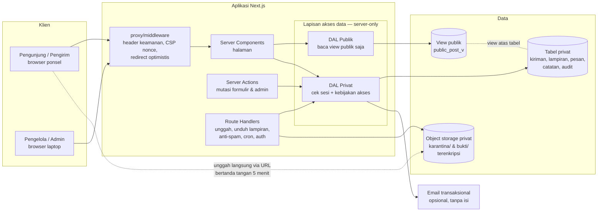
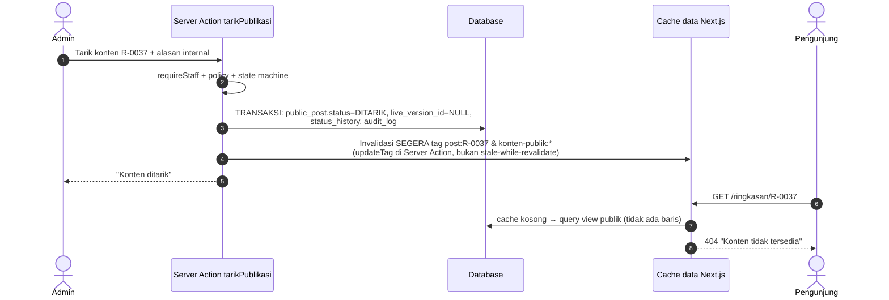
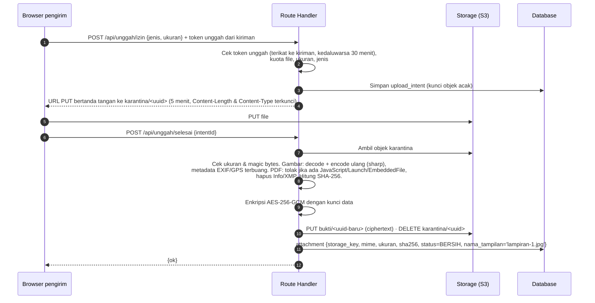
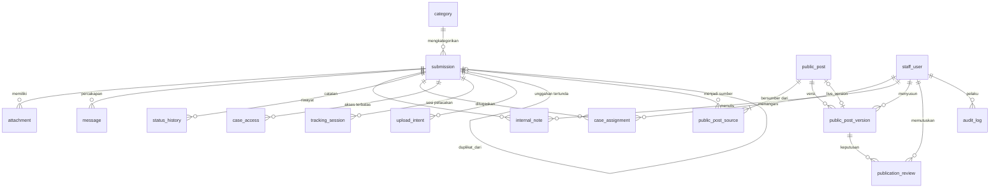

# 03 — Arsitektur, Teknologi, Model Data, dan Keamanan

> Mencakup: arsitektur dan rekomendasi teknologi (no. 8), rekomendasi database, autentikasi, penyimpanan, dan hosting, struktur rute dan folder Next.js, model data (no. 9), serta kontrol keamanan.
> Teknologi tetap: **Next.js (App Router) · TypeScript · Tailwind CSS · shadcn/ui · 21st.dev (Magic MCP)**. Teknologi lain di dokumen ini masih **rekomendasi** dan belum dipilih.

---

## 1. Gambaran arsitektur

Arsitekturnya **monolit modular** berupa satu aplikasi Next.js yang melayani website publik, pelacakan, dan dashboard. Isinya dipisah menjadi modul domain dengan **lapisan akses data (DAL)** yang memisahkan jalur publik dan privat sampai ke level koneksi database.



Keputusan kunci:

1. **Dua koneksi database dengan role berbeda.** `app_public` hanya boleh `SELECT` pada view publik. `app_private` dipakai DAL privat. Karena itu, bug di halaman publik **secara fisik** tidak dapat membaca tabel kiriman.
2. **Klien tidak pernah berbicara langsung dengan database.** Tidak ada SDK database di browser. Satu-satunya akses langsung ke storage adalah unggahan ke area karantina melalui URL bertanda tangan yang sekali pakai dan berumur pendek.
3. **Semua mutasi melalui Server Action atau Route Handler** yang memeriksa sesi, peran, akses kasus, dan aturan state machine di server.
4. **Portabel antarhosting.** Aplikasi memakai PostgreSQL standar (Drizzle ORM), storage berprotokol **S3-compatible**, dan auth sebagai library di dalam aplikasi. Opsi hosting A dan B memakai **kode yang sama**.

---

## 2. Rekomendasi database, autentikasi admin, penyimpanan file, dan hosting

### 2.1 Dua alternatif

| Aspek | **Opsi A — Terkelola (direkomendasikan untuk MVP)** | **Opsi B — Self-host di VPS Indonesia** |
|---|---|---|
| Hosting aplikasi | **Vercel** (fungsi di region Singapura `sin1`) | VPS penyedia lokal, Docker Compose: Next.js `output: standalone` di belakang **Caddy** (HTTPS otomatis) |
| Database | **Supabase Postgres** (region Singapura) — dipakai sebagai Postgres biasa. **Data API/PostgREST dinonaktifkan** atau tidak mengekspos skema aplikasi. | **PostgreSQL** di container/VM terpisah |
| Autentikasi admin | **Better Auth** (library di aplikasi, tabel di DB sendiri) + plugin **2FA TOTP** + undangan, pendaftaran publik dimatikan | Sama |
| Penyimpanan lampiran | **Supabase Storage** lewat **API S3-compatible**, bucket privat `karantina` (lifecycle 24 jam) dan `bukti` | Object storage S3-compatible dari penyedia lokal, atau self-host (Garage/SeaweedFS) |
| Pemindaian malware | MVP: validasi ketat + encode ulang/sanitasi (lihat §9). Lanjutan: worker ClamAV terpisah. | **ClamAV** sebagai container sidecar sejak MVP |
| Backup | DB: backup harian bawaan paket berbayar (+PITR opsional). Storage: **tidak tercakup backup DB**, sehingga perlu job salin terenkripsi ke bucket kedua di penyedia lain. | `pg_dump`/pgBackRest + `restic` ke lokasi kedua, terenkripsi |
| Lokasi data | Singapura. Perlu dicek terhadap kebijakan organisasi dan UU PDP (lihat Q1). | **Indonesia** |
| Perkiraan biaya/bulan* | ± US$45–70 (Vercel Pro + Supabase Pro), di luar email dan domain | ± Rp400 rb–1,2 jt (VPS 4 GB + storage + backup), di luar tenaga ops |
| Kemudahan pengembangan | ●●● preview deploy per PR, tanpa urusan server | ●● perlu pipeline deploy dan konfigurasi server |
| Keamanan | ●●● patch infrastruktur ditangani vendor, TLS/WAF bawaan. Sisi minus: log infrastruktur ada di vendor. | ●● kontrol penuh, tetapi patch OS, firewall, dan monitoring menjadi tanggung jawab tim |
| Pemeliharaan | ●●● rendah | ● butuh orang yang paham server |

\* Perkiraan kasar untuk volume kecil **[A4]**. Verifikasi harga terkini sebelum memutuskan. Paket gratis **tidak** disarankan untuk produksi karena tidak ada backup memadai dan proyek dapat dijeda saat tidak aktif.

### 2.2 Keputusan yang direkomendasikan

**Pakai Opsi A untuk MVP**, kecuali jawaban Q1 mewajibkan data disimpan di Indonesia. Dalam kasus itu, pakai Opsi B. Kode aplikasinya sama.

Alasan:

- **Kemudahan:** tim kecil **[A10]** bisa fokus pada fitur privasi dan alur kurasi, bukan pada server.
- **Biaya:** rendah dan dapat diprediksi untuk volume satu organisasi.
- **Keamanan:** TLS, patch, dan isolasi ditangani vendor. Kontrol yang paling penting, yaitu pemisahan role DB, enkripsi field dan lampiran, serta audit, berada di aplikasi sehingga tetap berlaku di kedua opsi.
- **Pemeliharaan:** tanpa server untuk dipatch. Better Auth dan Drizzle mencegah ketergantungan pada fitur khusus Supabase.

Mengapa **Better Auth** dan bukan Supabase Auth atau Auth.js:

| Pilihan | Penilaian |
|---|---|
| **Better Auth** ✅ | Library TypeScript yang berjalan di dalam aplikasi dengan data di DB sendiri, sehingga portabel ke Opsi B. Mendukung 2FA TOTP + kode cadangan, kontrol sesi, dan pembatasan laju login. Proyek Auth.js kini juga dikelola tim Better Auth. |
| Supabase Auth | Bagus, tetapi mengikat ke Supabase dan biasanya disertai klien Supabase di browser. Itu bertentangan dengan keputusan “klien tidak bicara dengan database”. |
| Auth.js | Fokusnya OAuth. Untuk email+kata sandi+TOTP, kodenya lebih banyak ditulis sendiri. |

---

## 3. Stack dan versi

| Lapisan | Pilihan | Catatan |
|---|---|---|
| Framework | **Next.js App Router** (tetap) | Gunakan rilis stabil terbaru saat inisialisasi (Next.js 16.x atau lebih baru). Konvensi `proxy.ts` (16+) menggantikan `middleware.ts`. |
| Bahasa | **TypeScript** `strict: true` (tetap) | `noUncheckedIndexedAccess` aktif |
| UI runtime | React 19.x (mengikuti Next.js) | — |
| Styling | **Tailwind CSS v4** (tetap) | Token lewat `@theme` di CSS |
| Komponen | **shadcn/ui** (tetap) + **21st.dev** via Magic MCP (referensi) | Komponen disalin ke repo, bukan dependensi runtime |
| Ikon | `lucide-react` | Bawaan shadcn |
| Formulir | `react-hook-form` + `zod` (skema dipakai bersama klien dan server) | Server selalu memvalidasi ulang |
| ORM & migrasi | **Drizzle ORM** + `drizzle-kit` | SQL eksplisit, tipe kuat, migrasi tersimpan di repo |
| Auth | **Better Auth** + plugin two-factor | Pendaftaran dimatikan, hanya lewat undangan |
| Storage | AWS SDK v3 `@aws-sdk/client-s3` + `s3-request-presigner` | Endpoint S3-compatible |
| Proses file | `sharp` (gambar) dan `pdf-lib` (metadata PDF) | Server-side |
| Anti-spam | **ALTCHA** (proof-of-work, open source, self-host) | Tanpa pelacakan pihak ketiga. Cloudflare Turnstile menjadi cadangan jika spam tinggi. |
| Email (opsional) | Penyedia transaksional (mis. Resend/SES) atau SMTP organisasi | Hanya isi generik |
| Logging | `pino` dengan daftar `redact` | Tanpa body permintaan |
| Uji | Vitest (unit/integrasi) dan **Playwright** (E2E + uji akses) | DB uji dengan container Postgres |
| Kualitas | ESLint, Prettier, `@axe-core/playwright`, Lighthouse CI | — |

Versi aktual **dikunci** di `package.json` dengan lockfile, lalu didokumentasikan di `docs/versi.md` saat inisialisasi: nama paket, versi, tanggal, dan alasan jika bukan versi terbaru. Sebelum fase prototipe, periksa kompatibilitas **shadcn/ui ↔ Tailwind v4 ↔ React 19 ↔ versi Next.js** dengan memasang 3 komponen percobaan (Button, Form, Dialog).

---

## 4. Struktur rute dan folder Next.js

> Formulir ditempatkan di `/kirim/pelanggaran` dan `/kirim/aspirasi` (bukan di bawah `/aspirasi/…`) agar tidak bentrok dengan rute dinamis `/aspirasi/[kode]` dan bisa memakai layout minimal sendiri. Pintasan `/lapor` dialihkan ke `/kirim/pelanggaran`.

```
lapor-pak/
├── src/
│   ├── app/
│   │   ├── (publik)/                       # layout: header + footer lengkap
│   │   │   ├── layout.tsx
│   │   │   ├── page.tsx                    # Beranda
│   │   │   ├── panduan/page.tsx
│   │   │   ├── kerahasiaan/page.tsx
│   │   │   ├── faq/page.tsx
│   │   │   ├── kontak/page.tsx
│   │   │   ├── kebijakan-privasi/page.tsx
│   │   │   ├── aspirasi/page.tsx           # daftar publik
│   │   │   ├── aspirasi/[kode]/page.tsx
│   │   │   ├── ringkasan/page.tsx          # daftar ringkasan pelanggaran
│   │   │   └── ringkasan/[kode]/page.tsx
│   │   ├── (formulir)/                     # layout: header minimal, tanpa tautan pengalih
│   │   │   ├── layout.tsx
│   │   │   ├── kirim/pelanggaran/page.tsx
│   │   │   └── kirim/aspirasi/page.tsx
│   │   ├── (lacak)/                        # layout minimal, noindex
│   │   │   ├── lacak/page.tsx              # masuk
│   │   │   └── lacak/kiriman/page.tsx      # butuh sesi pelacakan
│   │   ├── admin/
│   │   │   ├── masuk/page.tsx              # login + langkah 2FA
│   │   │   └── (dashboard)/                # layout: sidebar; requireStaff() di layout DAN di setiap aksi
│   │   │       ├── layout.tsx
│   │   │       ├── page.tsx
│   │   │       ├── kiriman/page.tsx
│   │   │       ├── kiriman/[id]/page.tsx
│   │   │       ├── kiriman/[id]/publikasi/page.tsx
│   │   │       ├── persetujuan/page.tsx
│   │   │       ├── konten-publik/page.tsx
│   │   │       ├── statistik/page.tsx
│   │   │       ├── audit/page.tsx
│   │   │       ├── pengguna/page.tsx
│   │   │       ├── pengaturan/page.tsx
│   │   │       └── akun/page.tsx
│   │   ├── api/
│   │   │   ├── auth/[...all]/route.ts      # Better Auth
│   │   │   ├── anti-spam/tantangan/route.ts# ALTCHA challenge
│   │   │   ├── unggah/izin/route.ts        # terbitkan URL unggah (karantina)
│   │   │   ├── unggah/selesai/route.ts     # proses & pindahkan ke bukti
│   │   │   ├── admin/lampiran/[id]/route.ts# unduh lampiran (cek akses, stream, audit)
│   │   │   └── cron/[tugas]/route.ts       # retensi, bersih karantina (CRON_SECRET)
│   │   ├── robots.ts · sitemap.ts
│   │   ├── not-found.tsx · error.tsx · global-error.tsx
│   │   └── layout.tsx                      # font, token, lang="id"
│   ├── components/
│   │   ├── ui/                             # shadcn/ui (disalin)
│   │   ├── publik/                         # kartu layanan, kartu konten, penafian…
│   │   ├── formulir/                       # stepper, unggah, kredensial…
│   │   └── admin/                          # tabel, panel privat/publik, dialog…
│   ├── server/                             # semua file diawali `import "server-only"`
│   │   ├── env.ts                          # validasi env dengan zod saat start
│   │   ├── db/
│   │   │   ├── schema/*.ts                 # Drizzle
│   │   │   ├── client-public.ts            # koneksi role app_public
│   │   │   └── client-private.ts           # koneksi role app_private
│   │   ├── dal/
│   │   │   ├── publik.ts                   # HANYA impor client-public
│   │   │   ├── kiriman.ts · publikasi.ts · pesan.ts · pelacakan.ts · pengguna.ts · statistik.ts
│   │   │   └── audit.ts
│   │   ├── auth/                           # konfigurasi Better Auth, requireStaff(), sesi pelacakan
│   │   ├── policy/                         # aturan akses: canViewSubmission, canApprove, …
│   │   ├── domain/                         # state machine penanganan & publikasi (fungsi murni)
│   │   ├── crypto/                         # token, HMAC, enkripsi field & file
│   │   ├── storage/                        # adapter S3
│   │   ├── files/                          # sanitasi gambar & PDF
│   │   ├── ratelimit/
│   │   └── notify/                         # email generik
│   ├── actions/                            # "use server" — tipis: validasi → policy → dal
│   │   ├── kirim.ts · pelacakan.ts
│   │   └── admin/{status,penugasan,pesan,catatan,publikasi,pengguna,pengaturan}.ts
│   ├── lib/
│   │   ├── schemas/                        # skema zod bersama
│   │   └── format/ · konstanta.ts
│   └── styles/tokens.css
├── proxy.ts                                # header keamanan, CSP nonce, noindex
├── drizzle/                                # migrasi SQL + skrip role & view
├── tests/{unit,integration,e2e}/
└── docs/                                   # perencanaan, versi, desain, runbook
```

Aturan impor yang dipaksakan oleh ESLint (`no-restricted-imports`):

- `components/**` dan file `"use client"` **tidak boleh** mengimpor `server/**`.
- `app/(publik)/**` hanya boleh mengimpor `server/dal/publik.ts` dan tidak boleh mengimpor DAL privat.
- `server/dal/publik.ts` hanya boleh mengimpor `db/client-public.ts`.

---

## 5. Pembagian Server Components dan Client Components

| Bagian | Jenis | Alasan |
|---|---|---|
| Layout, header, footer, halaman statis | Server | Tanpa JS yang tidak perlu |
| Daftar dan detail konten publik | Server | Data dari DAL publik dan bisa di-cache |
| Kontrol filter/pencarian publik | **Client** (kecil) | Mengubah query URL. Data tetap diambil di server. |
| Formulir pelanggaran/aspirasi, stepper, unggah | **Client** | Interaktif. State hanya di memori. Mengirim melalui Server Action dan Route Handler. |
| Layar kredensial berhasil | **Client** | Salin/unduh dan state sekali tampil |
| Halaman pelacakan | Server (data) + Client (form balasan, unggah) | Data dibaca berdasarkan sesi di server |
| Dashboard: tabel antrean | Server (data) + Client (tabel interaktif) | Paginasi dan filter di server lewat query URL |
| Dashboard: detail kiriman | Server | Sumber privat dirender di server. Hanya DTO yang dibutuhkan yang dikirim ke komponen klien. |
| Penyunting ringkasan, dialog persetujuan, tombol “Tampilkan identitas” | **Client** | Interaktif. Identitas diambil lewat aksi terpisah yang mengaudit, **bukan** dikirim sejak awal lalu disembunyikan dengan CSS. |
| Pratinjau publik | Server | Merender **komponen publik yang sama** dengan data versi draf |

Aturan DTO: komponen klien hanya menerima objek yang dibentuk fungsi DAL `toXxxDTO()`, bukan baris DB mentah. Sebagai lapisan tambahan, gunakan `experimental_taintUniqueValue` dan `taintObjectReference` dari React untuk kunci enkripsi dan baris berisi identitas jika stabil di versi yang dipakai.

---

## 6. Server Actions, Route Handlers, validasi, dan hak akses

### 6.1 Kapan memakai apa

| Operasi | Mekanisme | Alasan |
|---|---|---|
| Kirim laporan/aspirasi (teks) | Server Action | Terintegrasi dengan formulir. Body kecil. |
| Izin dan penyelesaian unggahan | Route Handler | File tidak lewat fungsi karena batas ukuran body serverless. Pemrosesan butuh `maxDuration` lebih panjang. |
| Masuk/keluar pelacakan, balas pesan, tarik izin | Server Action | — |
| Semua aksi admin (status, penugasan, pesan, catatan, versi, persetujuan, tarik, pengguna) | Server Action | — |
| Unduh lampiran admin | Route Handler | Streaming biner + header `Content-Disposition: attachment` |
| Tantangan anti-spam, auth, cron | Route Handler | Kebutuhan library atau pemanggilan eksternal |

### 6.2 Pola wajib setiap mutasi privat

Setiap Server Action adalah endpoint HTTP publik, jadi **setiap** aksi menjalankan urutan ini:

1. **Parse input** dengan skema Zod. Tolak field yang tidak dikenal (`strict`).
2. **Autentikasi**: `requireStaff()` membaca sesi dari DB, memastikan akun aktif, dan memastikan **2FA sudah diverifikasi** di sesi tersebut. Untuk pelacakan, gunakan `requireTrackingSession()`.
3. **Otorisasi** lewat `policy/`: peran, penugasan, daftar akses kasus terbatas, serta peran penyetuju yang sesuai jenis (pelanggaran: Admin, aspirasi: Pengelola/Admin). **ID kiriman pada aksi pelacakan diambil dari sesi, bukan dari input.**
4. **Aturan domain**: state machine (`domain/`) memastikan perpindahan sah dan syarat terpenuhi.
5. **Transaksi**: mutasi + `status_history` + `audit_log` di-commit bersama.
6. **Invalidasi cache** jika konten publik terdampak (§7.2).
7. **Kembalikan hasil minimal** (`{ ok, pesan }` atau DTO). Galat dikembalikan sebagai pesan generik, sedangkan detail hanya masuk log tanpa data sensitif.

`proxy.ts` dan `layout.tsx` admin hanya melakukan **redirect optimistis** untuk kenyamanan. Keduanya **bukan** batas keamanan. Batas keamanan ada di DAL dan aksi.

---

## 7. Cache, pembaruan konten publik, lampiran, dan secret

### 7.1 Kebijakan cache

| Area | Kebijakan |
|---|---|
| Data konten publik (DAL publik) | Di-cache di level fungsi data (`'use cache'` + `cacheTag`, jika memakai Cache Components) dengan tag `konten-publik`, `konten-publik:aspirasi`, `konten-publik:pelanggaran`, dan `post:<kode>`. Umur maksimal beberapa jam sebagai jaring pengaman. |
| HTML halaman | **Dirender dinamis** per permintaan karena CSP nonce memerlukan render dinamis. Ini juga menghindari HTML basi di CDN setelah penarikan. Volume satu organisasi membuat biaya render ini kecil. |
| Formulir, pelacakan, admin, API | `Cache-Control: no-store, private` (via `proxy.ts`). Tanpa cache data. Membaca cookie membuat rute dinamis. |
| Aset statis | Cache panjang dan immutable (bawaan Next.js) |
| Header `X-Robots-Tag: noindex, nofollow` | `/admin/*`, `/lacak/*`, `/kirim/*`, `/api/*`, `/ringkasan/*` (rekomendasi) |

### 7.2 Memperbarui atau menghapus konten publik setelah persetujuan berubah



Aturan:

- **Penarikan dan publikasi wajib memakai invalidasi segera.** Jangan memakai mode stale-while-revalidate yang masih bisa menyajikan satu respons basi. Di Next.js 16, gunakan `updateTag` di Server Action. Verifikasi API pada versi yang dipakai dan tulis uji E2E untuk memastikannya.
- View publik hanya menampilkan baris dengan `status = DIPUBLIKASIKAN` **dan** `live_version_id` tidak null. Walaupun cache gagal diinvalidasi, umur cache maksimum membatasi paparan, sedangkan DB sudah benar.
- Konten yang ditarik mengembalikan **404** generik. Respons tidak membedakan “ditarik” dan “tidak pernah ada”.
- Sitemap hanya berisi halaman statis dan aspirasi tayang. Setelah penarikan, halaman tersebut otomatis hilang dari sitemap.
- Versi baru setelah publikasi **tidak mengubah** `live_version_id` sampai versi itu disetujui. Halaman publik tetap menampilkan versi lama.

### 7.3 Penyimpanan dan akses lampiran privat



- Nama file asli **tidak disimpan** karena bisa memuat nama orang. Lampiran ditampilkan sebagai `lampiran-N.ext`.
- Bucket bersifat privat tanpa URL publik. Admin **tidak pernah** menerima URL storage langsung. Unduhan lewat `/api/admin/lampiran/[id]` mengikuti alur: cek sesi dan akses → dekripsi → stream dengan `Content-Disposition: attachment`, `X-Content-Type-Options: nosniff`, `Cache-Control: no-store` → catat audit `ATTACHMENT_DOWNLOADED`.
- Objek karantina yang tidak selesai diproses dihapus otomatis oleh lifecycle bucket atau cron dalam 24 jam.

### 7.4 Secret dan kredensial

| Secret | Kegunaan |
|---|---|
| `DATABASE_URL_PUBLIC` / `DATABASE_URL_APP` | Koneksi role `app_public` / `app_private` |
| `DATABASE_URL_MIGRATE` | Hanya di CI saat migrasi, **tidak** ada di runtime aplikasi |
| `BETTER_AUTH_SECRET` | Tanda tangan sesi admin |
| `DATA_ENCRYPTION_KEYS` | Kunci AES-256 untuk field dan lampiran, dengan `key_id` agar bisa dirotasi |
| `TRACKING_PEPPER` | HMAC kunci rahasia pelacakan |
| `IP_HASH_SECRET` | HMAC IP untuk pembatasan laju, dicampur garam harian |
| `S3_ENDPOINT`, `S3_ACCESS_KEY_ID`, `S3_SECRET_ACCESS_KEY` | Storage |
| `ALTCHA_HMAC_KEY` | Anti-spam |
| `CRON_SECRET` | Memanggil rute cron |
| `EMAIL_API_KEY` | Opsional |

Aturan secret:

- Tidak ada secret ber-prefix `NEXT_PUBLIC_`.
- `server/env.ts` memvalidasi semua env saat start dan gagal cepat jika ada yang hilang.
- Secret disimpan di pengelola env hosting dengan nilai berbeda per lingkungan (dev, preview, produksi). Preview deploy **tidak** memakai DB produksi.
- `.env*` ada di `.gitignore`. Pemindai secret dijalankan di CI.
- Kunci enkripsi dicadangkan **terpisah** dari backup DB. Tanpa kunci, backup tidak dapat dibaca. Itu memang tujuan pemisahan ini, tetapi kehilangan kunci berarti kehilangan data.

---

## 8. Model data dan hubungan antarentitas

### 8.1 Diagram hubungan entitas



### 8.2 Entitas dan kolom utama

Konvensi: ID memakai `uuid` (v7). Waktu disimpan sebagai `timestamptz` dalam UTC. Kolom bertanda 🔐 dienkripsi di aplikasi (AES-256-GCM, disimpan sebagai `bytea` + `key_id`).

| Entitas | Kolom utama | Catatan |
|---|---|---|
| **submission** (kiriman) | `id`, `type` (`PELANGGARAN`/`ASPIRASI`), `reference_no` (unik, acak, mis. `WBS-26-7K3Q-XR9T`), `tracking_key_hash`, `tracking_key_version`, `category_id`, `title`, `body`, `expected_outcome` (aspirasi), `incident_time_kind` + `incident_date`/`incident_month`, `location_text`, `involved_parties` 🔐, `knowledge_source`, `reported_elsewhere`, `reporter_name` 🔐, `reporter_contact` 🔐, `publication_consent` (bool) + `consent_changed_at`, `involves_staff` (bool), `is_restricted` (bool), `handling_status`, `outcome` (enum hasil/tanggapan), `priority`, `publication_locked` (bool) + `publication_lock_reason` (internal), `duplicate_of_id`, `closed_reason`, `failed_track_attempts`, `track_locked_until`, `retention_due_at`, `created_at`, `updated_at`, `last_reporter_activity_at` | **Tidak ada** kolom IP atau user-agent |
| **attachment** | `id`, `submission_id`, `uploaded_by` (`PENGIRIM`/`STAF`), `message_id` (nullable), `storage_key`, `display_name`, `mime`, `size_bytes`, `sha256`, `scan_status` (`TERTUNDA`/`BERSIH`/`DITOLAK`/`GAGAL`), `metadata_stripped` (bool), `enc_key_id`, `created_at` | Isi file terenkripsi di storage |
| **upload_intent** | `id`, `submission_id`, `object_key`, `declared_mime`, `declared_size`, `expires_at`, `completed_at` | Dibersihkan setelah 24 jam |
| **tracking_session** | `id_hash`, `submission_id`, `created_at`, `last_seen_at`, `expires_at` | Idle 30 menit dan absolut 2 jam. Dihapus saat keluar. |
| **message** (pesan ke/dari pengirim) | `id`, `submission_id`, `direction` (`KE_PENGIRIM`/`DARI_PENGIRIM`), `body`, `author_staff_id` (null jika dari pengirim), `created_at`, `read_at` | Nama staf **tidak** ditampilkan ke pengirim. Label yang ditampilkan: “Petugas”. |
| **internal_note** | `id`, `submission_id`, `author_id`, `body`, `created_at` | Tidak pernah dikembalikan oleh DAL publik atau pelacakan |
| **status_history** | `id`, `submission_id`, `dimension` (`PENANGANAN`/`HASIL`/`PUBLIKASI`/`KUNCI`), `from_value`, `to_value`, `internal_reason`, `visible_to_reporter` (bool), `reporter_label`, `actor_type` (`STAF`/`PENGIRIM`/`SISTEM`), `actor_id`, `created_at` | Linimasa pengirim = baris dengan `visible_to_reporter = true`, hanya kolom label dan waktu |
| **case_assignment** | `submission_id`, `staff_id`, `role_in_case` (`PIC`/`ANGGOTA`), `assigned_by`, `assigned_at`, `unassigned_at` | — |
| **case_access** | `submission_id`, `staff_id`, `granted_by`, `granted_at` | Hanya berlaku jika `is_restricted` |
| **public_post** (konten publik) | `id`, `public_code` (urut per jenis: `A-0142`, `R-0037`), `type`, `status` (status publikasi), `live_version_id`, `first_published_at`, `withdrawn_at`, `withdraw_reason` (internal) | **Tidak** memiliki kolom yang menyimpan isi asli |
| **public_post_source** | `public_post_id`, `submission_id` | Satu konten dapat bersumber dari beberapa aspirasi serupa. Persetujuan mensyaratkan **semua** sumber memberi izin dan tidak dikunci. |
| **public_post_version** | `id`, `public_post_id`, `version_no`, `title`, `summary`, `public_category`, `period_label`, `location_label`, `public_status`, `public_response`, `outcome_statement` (pelanggaran, opsional), `change_reason` (internal), `state` (`DRAF`/`DIAJUKAN`/`PERLU_REVISI`/`DISETUJUI`/`DITOLAK`/`DIGANTIKAN`), `drafted_by`, `last_edited_by`, `submitted_at`, `created_at` | **Imutabel setelah diajukan**. Perubahan berarti membuat versi baru. |
| **publication_review** | `id`, `version_id`, `reviewer_id`, `decision` (`SETUJU`/`REVISI`/`TOLAK`), `checklist` (jsonb), `internal_note`, `created_at` | **Satu persetujuan cukup**, dan penyetuju boleh sama dengan `drafted_by`. Trigger DB menolak keputusan `SETUJU` jika `checklist` belum lengkap atau peran `reviewer_id` tidak sesuai jenis konten. Keputusan swa-setuju (`reviewer_id = drafted_by`) ditandai di audit agar mudah ditinjau. |
| **staff_user** (+ tabel Better Auth: session, account, verification, two_factor) | `id`, `name`, `email`, `role` (`PENGELOLA`/`ADMIN`, dapat diperluas ke `KURATOR`/`PENANGAN`), `is_active`, `two_factor_enabled`, `last_login_at`, `invited_by` | Tanpa pendaftaran publik |
| **staff_invitation** | `id`, `email`, `role`, `token_hash`, `expires_at`, `accepted_at`, `invited_by` | Kedaluwarsa 48 jam |
| **category** | `id`, `type`, `name`, `description`, `is_active`, `sort_order` | — |
| **setting** | `key`, `value` (jsonb) | Teks kontak, kontak darurat, retensi, batas lampiran |
| **audit_log** | `id`, `occurred_at`, `actor_type`, `actor_id`, `action` (mis. `SUBMISSION_VIEWED`, `IDENTITY_REVEALED`, `ATTACHMENT_DOWNLOADED`, `STATUS_CHANGED`, `VERSION_APPROVED`, `POST_WITHDRAWN`, `LOGIN_FAILED`), `object_type`, `object_id`, `meta` (jsonb **tanpa isi kiriman**), `reason` | **Append-only**: role aplikasi hanya punya `INSERT, SELECT`. Rantai hash opsional di fase lanjutan. |
| **rate_limit** | `bucket_key_hash`, `window_start`, `count`, `expires_at` | Dibersihkan berkala |
| **stat_monthly** | `month`, `type`, `category_id`, `handling_status`, `count` | Snapshot agregat agar statistik tetap ada setelah data dihapus sesuai retensi |

Pemetaan istilah di dokumen 01 ke kolom:

| Istilah | Kolom |
|---|---|
| `publikasi_dikunci` | `submission.publication_locked` |
| `duplikat_dari` | `submission.duplicate_of_id` |
| status penanganan / hasil verifikasi / jenis tanggapan | `submission.handling_status` / `submission.outcome` |
| `alasan_internal` | `status_history.internal_reason`, `publication_lock_reason`, `withdraw_reason`, `publication_review.internal_note` |
| `catatan_internal` | `internal_note.body` |

**Format kredensial:**

- **Nomor Referensi**: `WBS-` atau `ASP-` + 2 digit tahun + 8 karakter Crockford Base32 acak (40 bit). Nomor ini bukan rahasia, tetapi **tidak berurutan** supaya tidak membocorkan volume kiriman dan tidak bisa ditebak beruntun.
- **Kunci Rahasia**: 24 karakter Crockford Base32 dari CSPRNG (120 bit), ditampilkan per 4 karakter. Yang disimpan hanya `HMAC-SHA256(TRACKING_PEPPER, kunci)`. Entropi tinggi membuat hash lambat tidak diperlukan, sedangkan pepper melindungi jika hanya DB yang bocor. Pembandingan dilakukan *constant-time*.

### 8.3 Pemisahan data privat dan publik

```mermaid
flowchart TB
    subgraph schema_app[Skema app — privat]
        sub[submission] --- att[attachment]
        sub --- msg[message] --- note[internal_note]
        pp[public_post] --- ppv[public_post_version]
    end
    subgraph schema_pub[Skema pub — hanya view]
        v1[public_post_v]
        v2[public_category_v]
    end
    ppv -->|hanya versi live dari post DIPUBLIKASIKAN| v1
    R1([role app_public]) -->|SELECT saja| schema_pub
    R2([role app_private]) -->|CRUD terbatas, audit_log INSERT-only| schema_app
    R1 -.x.-> schema_app
```

- **View `pub.public_post_v`** hanya memuat kolom aman: `public_code`, `type`, `title`, `summary`, `public_category`, `period_label`, `location_label`, `public_status`, `public_response`, `outcome_statement`, `first_published_at`, `updated_at`. Syaratnya `status = 'DIPUBLIKASIKAN' AND live_version_id IS NOT NULL`. View ini **tidak memuat** `submission_id`, ID internal, alasan, atau catatan.
- Role `app_public` **tidak memiliki** hak apa pun pada skema `app`. Sekalipun terjadi kesalahan kode atau injeksi pada jalur publik, tabel privat tetap tidak terjangkau.
- **API publik** berarti fungsi di `dal/publik.ts` yang dipakai Server Components. Tidak ada endpoint JSON publik di MVP. Jika nanti dibutuhkan, endpoint tersebut membaca view yang sama.
- **Pratinjau** di dashboard memakai komponen publik yang sama, tetapi datanya diambil oleh DAL privat dari versi draf. Pratinjau tidak pernah melewati cache publik.
- **Pelacakan** memakai DAL privat dengan fungsi khusus `getSubmissionForReporter(sessionSubmissionId)` yang mengembalikan DTO pengirim. DTO ini tidak memuat catatan internal, nama staf, alasan internal, atau `case_*`.
- **Uji arsitektur otomatis**: (1) uji integrasi membuktikan `app_public` gagal `SELECT` dari `app.submission`. (2) Snapshot kolom view publik gagal jika ada kolom baru tanpa review. (3) Lint aturan impor dijalankan.

---

## 9. Keamanan dan pencegahan penyalahgunaan

Keterangan: **MVP** = wajib sebelum go-live · **Lanjutan** = setelah MVP atau ketika risiko atau volume meningkat.

| Area | MVP | Lanjutan |
|---|---|---|
| **Autentikasi admin** | Login email + kata sandi (min. 12 karakter, cek terhadap daftar sandi umum). **2FA TOTP wajib** dengan kode cadangan. Akun tanpa 2FA hanya dapat membuka halaman penyiapan 2FA. Sesi berbasis DB dengan cookie `__Host-`, `httpOnly`, `Secure`, `SameSite=Lax`, idle 30 menit dan absolut 8 jam. Pembatasan laju dan penguncian bertahap untuk login gagal. Pendaftaran publik mati, hanya undangan 48 jam. Login dan logout tercatat di audit. | Passkey/WebAuthn, SSO organisasi, pembatasan IP admin, notifikasi login dari perangkat baru |
| **Hak akses** | Policy terpusat di `server/policy`. Pemeriksaan di setiap aksi dan DAL. Peran penyetuju dan checklist lengkap ditegakkan di aplikasi **dan** trigger DB (satu penyetuju, boleh penyusun). Kasus terbatas. Identitas tersembunyi dengan alasan dan audit saat dibuka. Admin dapat menonaktifkan akun seketika (sesi dicabut). | Peran Kurator/Penangan terpisah, akses berbatas waktu, review akses berkala |
| **Token pelacakan** | Kunci 120 bit dari CSPRNG. Disimpan sebagai HMAC + pepper. Dikirim lewat **POST**, tidak pernah di URL. Sesi pelacakan di cookie `httpOnly`, `Secure`, `SameSite=Strict`, `path=/lacak`, terikat ke satu kiriman. Pesan galat generik. Pembatasan laju: 10 percobaan/jam per IP-hash dan kunci 15 menit setelah 5 gagal per nomor referensi. | Rotasi kunci oleh pengirim, kunci berbasis frasa kata, deteksi pola brute-force terdistribusi |
| **Nomor referensi vs kredensial** | Nomor referensi acak dan tidak berurutan, tetapi **tidak cukup** untuk mengakses. Kode konten publik (`A-0142`) terpisah dari nomor referensi dan tidak dapat dipakai untuk mencari kiriman. | — |
| **Spam & pembatasan** | ALTCHA proof-of-work + honeypot + waktu isi minimum. Batas laju 5 kiriman/jam/IP-hash dan 20/hari. Batas global sebagai pemutus darurat. Hash IP memakai garam harian dan dihapus ≤ 24 jam. Idempotency key mencegah kiriman ganda. | Turnstile/hCaptcha saat serangan. Aturan WAF hosting. Skor heuristik spam (tautan, kata kunci). |
| **Validasi & sanitasi** | Zod di server untuk setiap input dengan panjang maksimum, enum, dan `strict`. Teks disimpan polos dan **di-escape saat render**. Tidak ada `dangerouslySetInnerHTML` untuk konten pengguna. Query terparameterisasi (Drizzle). Normalisasi Unicode dan pembuangan karakter kontrol. | Pustaka sanitasi jika nanti mendukung teks kaya |
| **Lampiran** | Allowlist JPG/PNG/WebP/PDF. Cek magic bytes. Maks. 10 MB/file dan 5 file per kiriman. Unggah langsung ke karantina dengan URL bertanda tangan 5 menit. Gambar di-**encode ulang** (metadata hilang dan payload polyglot ternetralkan). PDF ditolak jika memiliki JS/aksi otomatis/file sematan, lalu metadata Info/XMP dibuang. **Enkripsi di level aplikasi.** Unduh hanya sebagai `attachment`. Tidak pernah ditampilkan inline di domain utama. | **ClamAV** worker (sejak MVP jika Opsi B). Konversi PDF menjadi gambar untuk pratinjau aman. Dukungan video/audio dengan pemrosesan terpisah. |
| **Metadata identitas** | Pembersihan metadata pada lampiran. Nama file asli dibuang. Halaman kerahasiaan menjelaskan risiko isi visual. | Deteksi wajah dan plat untuk peringatan kurator (berjalan lokal) |
| **Data at rest** | Enkripsi disk dari penyedia. **Enkripsi field** untuk identitas, kontak, dan pihak terlibat. Enkripsi lampiran. Kunci di secret manager, terpisah dari backup. | Enkripsi uraian penuh, KMS dengan envelope encryption, rotasi kunci terjadwal |
| **Audit** | `audit_log` append-only untuk semua akses baca detail kiriman, buka identitas, unduh lampiran, perubahan status, keputusan publikasi, penarikan, dan perubahan akun. Admin dapat melihat dan memfilter. Isi kiriman tidak pernah ditulis ke audit. | Rantai hash anti-rusak, ekspor ke penyimpanan WORM, peringatan anomali (mis. unduhan massal) |
| **Backup & pemulihan** | Backup DB harian dengan retensi 7–30 hari. Salinan storage harian terenkripsi ke penyedia kedua. **Uji pemulihan** sebelum go-live dan setiap triwulan. Runbook pemulihan tertulis. Target RPO 24 jam dan RTO 8 jam **[A11]**. | PITR. Replikasi lintas region. |
| **Retensi & penghapusan** | Retensi dapat diatur di pengaturan. Usulan awal: spam 30 hari; ditutup lainnya 1 tahun; selesai 5 tahun (**dikonfirmasi, Q1**). Cron harian menghapus baris + objek storage + menarik konten publik terkait. Audit mencatat penghapusan tanpa isi. Hapus manual oleh Admin dengan konfirmasi. Data di backup ikut hilang saat masa backup habis, dan hal ini dijelaskan di kebijakan privasi. | Permintaan penghapusan dari pengirim lewat pelacakan, legal hold untuk kasus yang berproses hukum |
| **Kebocoran via URL** | Kredensial tidak pernah di URL. Detail pelacakan tanpa ID di URL. `Referrer-Policy: no-referrer`. Tautan keluar memakai `rel="noreferrer noopener"`. Judul tab generik (“Pelacakan Kiriman”). | — |
| **Kebocoran via log** | Logger dengan `redact` (body, kunci, cookie, authorization, email, nama). Body permintaan formulir tidak pernah di-log. Log aplikasi tanpa IP. Retensi log hosting diatur seminimal mungkin. | Log terpusat dengan kontrol akses |
| **Analitik** | **Tidak ada analitik pihak ketiga** di MVP. Jika diperlukan, hanya hitungan halaman agregat di sisi server yang mengecualikan `/kirim`, `/lacak`, dan `/admin`. Tanpa session replay, piksel iklan, atau font, CDN, dan skrip pihak ketiga. | Analitik self-host tanpa cookie |
| **Notifikasi** | Email ke pengirim (jika diaktifkan) berbunyi “Ada pembaruan pada kiriman Anda. Silakan buka halaman pelacakan.” **Tanpa** nomor referensi, kunci, atau isi. Email ke staf hanya berisi jumlah dan tautan dashboard. | Notifikasi web push, ringkasan harian staf |
| **Mesin pencari** | `noindex` untuk `/admin`, `/lacak`, `/kirim`, `/api`, `/ringkasan`. Sitemap hanya berisi halaman statis dan aspirasi tayang. Konten ditarik → 404. | Permintaan penghapusan URL ke mesin pencari untuk konten sensitif yang ditarik |
| **Header & transport** | HTTPS + HSTS. CSP dengan nonce (`default-src 'self'`, `object-src 'none'`, `base-uri 'none'`, `frame-ancestors 'none'`, `form-action 'self'`, `connect-src` hanya ke domain sendiri + endpoint storage untuk unggah). `X-Content-Type-Options: nosniff`. `Permissions-Policy` membatasi kamera, mikrofon, dan geolokasi. | CSP report endpoint, SRI |
| **Rantai pasok** | Lockfile, `npm audit`/Dependabot, pemindai secret di CI, review kode komponen 21st.dev seperti kode pihak ketiga | SBOM, penandatanganan build |
| **Operasional** | Prinsip *least privilege* untuk akses hosting dan DB (2FA di akun vendor). Lingkungan preview memakai data sintetis. Kebijakan respons insiden 1 halaman. | Uji penetrasi independen sebelum skala besar, program pengungkapan kerentanan |
