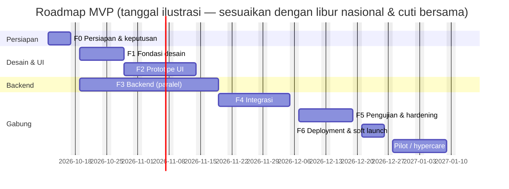
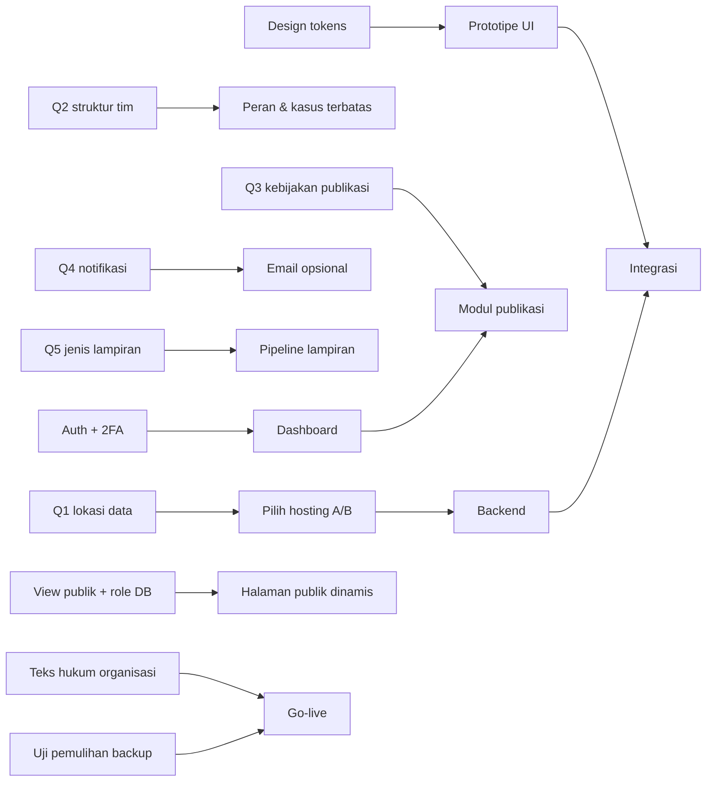

# 04 — Backlog, Roadmap, Risiko, dan Pengujian

> Mencakup: backlog berdasarkan prioritas (no. 10), roadmap beserta ketergantungan dan asumsi estimasi (no. 11), risiko dan mitigasi (no. 12), serta acceptance criteria dan skenario pengujian (no. 13).

---

## 1. Backlog fitur berdasarkan prioritas

Prioritas:

- **P0** wajib ada sebelum go-live.
- **P1** sebaiknya ada di MVP, tetapi dapat digeser ke rilis 1.1 bila waktu sempit.
- **P2** setelah MVP.

Estimasi dihitung dalam **hari kerja pengembang**, termasuk uji unit atau integrasi untuk item tersebut.

### E0 — Fondasi proyek

| ID | Item | Prio | Est. |
|---|---|:-:|:-:|
| B-01 | Inisialisasi Next.js + TS strict + Tailwind v4 + shadcn/ui, ESLint/Prettier, `docs/versi.md`, uji kompatibilitas 3 komponen | P0 | 1 |
| B-02 | CI: typecheck, lint, unit test, pemindai secret, audit dependensi | P0 | 1 |
| B-03 | `server/env.ts`, struktur `server-only`, aturan batas impor ESLint (publik ↛ privat, klien ↛ server) | P0 | 0,5 |

### E1 — Design system

| ID | Item | Prio | Est. |
|---|---|:-:|:-:|
| B-04 | Design tokens, font self-host, tema shadcn, halaman katalog komponen internal | P0 | 1,5 |
| B-05 | Komponen dasar disesuaikan: tombol, field + label wajib/opsional, badge penanganan & publikasi, kartu, alert, dialog, toast | P0 | 2 |
| B-06 | Komponen khusus via workflow 21st.dev **[MCP]**: kartu layanan, stepper, unggah lampiran, tampilan kredensial, timeline, panel PRIVAT/PUBLIK | P0 | 3 |
| B-07 | Verifikasi kontras dan aksesibilitas komponen (axe + keyboard) | P0 | 0,5 |

### E2 — Website publik

| ID | Item | Prio | Est. |
|---|---|:-:|:-:|
| B-08 | Layout publik, header + menu ponsel, footer, skip link | P0 | 1 |
| B-09 | Beranda (kartu layanan, cara kerja, kotak lacak, konten terbaru, kontak darurat) | P0 | 1,5 |
| B-10 | Halaman panduan, kerahasiaan, FAQ, kontak, kebijakan privasi (teks dari organisasi) | P0 | 1,5 |
| B-11 | Daftar dan detail aspirasi + pencarian, filter kategori/status publik, paginasi | P0 | 2 |
| B-12 | Daftar dan detail ringkasan pelanggaran + penafian | P0 | 1 |
| B-13 | `robots`, `sitemap`, `X-Robots-Tag`, halaman 404/galat | P0 | 0,5 |

### E3 — Formulir dan pengiriman

| ID | Item | Prio | Est. |
|---|---|:-:|:-:|
| B-14 | Skema dan migrasi: `submission`, `category`, `status_history`, `audit_log` | P0 | 1,5 |
| B-15 | Formulir pelanggaran bertahap (state di memori, validasi, ringkasan, peringatan keluar) | P0 | 3 |
| B-16 | Formulir aspirasi satu halaman + konfirmasi | P0 | 1 |
| B-17 | Server Action kirim: validasi Zod, transaksi, Nomor Referensi, Kunci Rahasia (HMAC), idempotency | P0 | 2 |
| B-18 | ALTCHA + honeypot + pembatasan laju berbasis IP-hash harian | P0 | 1,5 |
| B-19 | Pipeline lampiran: izin unggah, karantina, sanitasi gambar/PDF, enkripsi, finalisasi, pembersihan | P0 | 4 |
| B-20 | Layar berhasil: salin, unduh `.txt`, konfirmasi simpan | P0 | 0,5 |

### E4 — Pelacakan tanpa login

| ID | Item | Prio | Est. |
|---|---|:-:|:-:|
| B-21 | Masuk pelacakan, sesi terikat satu kiriman, pembatasan dan penguncian | P0 | 2 |
| B-22 | Halaman kiriman: status, linimasa pengirim, salinan laporan | P0 | 1,5 |
| B-23 | Pesan dua arah; balasan pengirim memindahkan `BUTUH_INFO → DITINJAU` | P0 | 1,5 |
| B-24 | Tambah lampiran dari pelacakan | P1 | 1 |
| B-25 | Tarik izin publikasi (otomatis tarik konten + kunci) | P0 | 1 |

### E5 — Dashboard penanganan

| ID | Item | Prio | Est. |
|---|---|:-:|:-:|
| B-26 | Better Auth: login, 2FA wajib, kode cadangan, undangan, sesi, batas login | P0 | 3 |
| B-27 | `policy/` + `requireStaff()` + uji matriks akses | P0 | 2 |
| B-28 | Antrean: tabel, tab, filter, pencarian, paginasi server | P0 | 2 |
| B-29 | Detail kiriman: panel PRIVAT, identitas tersembunyi + alasan, unduh lampiran teraudit | P0 | 2,5 |
| B-30 | State machine penanganan + aksi ubah status + riwayat + hasil | P0 | 2 |
| B-31 | Catatan internal + penugasan | P0 | 1,5 |
| B-32 | Kasus terbatas + daftar akses | P1 | 1,5 |
| B-33 | Tandai duplikat, spam, atau di luar lingkup | P0 | 1 |
| B-34 | Halaman ringkasan kerja (beranda admin) | P1 | 1 |

### E6 — Kurasi dan publikasi

| ID | Item | Prio | Est. |
|---|---|:-:|:-:|
| B-35 | Skema `public_post`/`version`/`review`/`source`, skema `pub`, view publik, role `app_public` | P0 | 2 |
| B-36 | Penyunting versi + checklist penyusun + pratinjau memakai komponen publik | P0 | 3 |
| B-37 | Penanda data pribadi lokal (email, telepon, NIK/NIP, plat, sapaan nama) | P1 | 1 |
| B-38 | Antrean persetujuan + dialog checklist + konfirmasi penanda data pribadi + “Ajukan & setujui”, satu penyetuju sesuai peran (aplikasi + trigger DB) | P0 | 2 |
| B-39 | Publikasi, penarikan, versi baru setelah tayang, invalidasi cache segera | P0 | 2 |
| B-40 | Diff antarversi | P1 | 1 |
| B-41 | Pengelompokan beberapa aspirasi menjadi satu konten publik | P2 | 2 |

### E7 — Administrasi dan audit

| ID | Item | Prio | Est. |
|---|---|:-:|:-:|
| B-42 | Manajemen pengguna dan undangan, nonaktifkan, reset 2FA | P0 | 1,5 |
| B-43 | Kategori dan pengaturan (kontak, darurat, retensi, batas lampiran) | P0 | 1,5 |
| B-44 | Penampil audit log + filter | P0 | 2 |
| B-45 | Statistik agregat + snapshot bulanan | P1 | 2 |

### E8 — Keamanan dan operasional

| ID | Item | Prio | Est. |
|---|---|:-:|:-:|
| B-46 | Enkripsi field dan file + `key_id` + prosedur cadangan kunci | P0 | 1,5 |
| B-47 | Header keamanan, CSP nonce, `no-store`, `Referrer-Policy`, logger dengan redaksi | P0 | 1,5 |
| B-48 | Backup DB dan storage, **uji pemulihan**, runbook | P0 | 2 |
| B-49 | Cron retensi dan penghapusan permanen | P1 | 1,5 |
| B-50 | Notifikasi email generik (jika Q4 = ya) | P1 | 1,5 |
| B-51 | Monitoring uptime dan peringatan galat tanpa PII | P1 | 1 |
| B-52 | Suite E2E keamanan, akses, dan aksesibilitas (§4) | P0 | 4 |

**Total:** P0 ≈ **73,5 hari** · P1 ≈ **11,5 hari** · P0+P1 ≈ **85 hari kerja pengembang**.

### Lanjutan (P2) — dievaluasi setelah MVP berjalan 2–3 bulan

| Fitur | Prasyarat evaluasi |
|---|---|
| Komentar publik pada aspirasi | Kapasitas moderasi, kebijakan komentar, dan perlindungan dari serangan pribadi |
| Voting/dukungan aspirasi | Mekanisme anti-manipulasi tanpa akun dan dampak pada prioritas |
| Fitur sosial (bagikan, ikuti) | Risiko penyebaran ringkasan pelanggaran |
| Pemindaian ClamAV (Opsi A) | Volume lampiran dan insiden |
| Passkey, SSO organisasi | Jumlah staf |
| Rotasi kunci dan permintaan hapus data oleh pengirim | Masukan pengguna |
| Lampiran video/audio/Office | Hasil Q5 dan biaya pemrosesan |
| Statistik publik, laporan tahunan | Ambang anonimitas angka kecil |
| Multi-bahasa, mode gelap | Data pengguna |
| Audit dengan rantai hash, otomatisasi SLA dan eskalasi | Kebutuhan kepatuhan |

---

## 2. Roadmap pengembangan

### 2.1 Asumsi estimasi

- Tim terdiri dari **2 pengembang full-stack** dan **1 desainer/PO paruh waktu** **[A10]**. Satu pengembang condong ke frontend, satu lagi ke backend.
- Ada 1 pihak organisasi yang mengambil keputusan dan tersedia untuk review mingguan dan UAT.
- Jawaban Q1–Q5 diperoleh di **minggu 1**. Keterlambatan menggeser fase backend.
- Teks hukum (kebijakan privasi, ketentuan) dan konten FAQ disediakan organisasi paling lambat minggu 8.
- Ada buffer **±15%** di setiap fase untuk review dan perbaikan.
- **Jika hanya ada 1 pengembang:** P0 saja membutuhkan ± 16–18 minggu. Alternatif lain, P1 dipindah ke rilis 1.1.

### 2.2 Fase

| Fase | Minggu | Fokus | Keluaran | Bergantung pada | Kriteria selesai |
|---|:-:|---|---|---|---|
| **F0 Persiapan & keputusan** | 1 | Jawab Q1–Q5, pilih hosting (A/B), buat akun vendor dengan 2FA, inisialisasi repo | B-01…B-03, `docs/versi.md`, keputusan tertulis | — | Keputusan hosting dan kebijakan publikasi disetujui |
| **F1 Fondasi desain** | 2–3 | Design tokens, komponen dasar, workflow 21st.dev pertama | B-04…B-07, katalog komponen | F0 | Token dipakai semua komponen dasar. Kontras lolos. Komponen lolos gerbang 21st.dev. |
| **F2 Prototipe UI** | 3–5 | Semua halaman publik, formulir, pelacakan, dan dashboard dengan **data sintetis** | Prototipe yang dapat diklik, hasil uji kegunaan 5 orang (3 calon pengirim, 2 pengelola) | F1 | Temuan kritis uji kegunaan sudah diperbaiki. Wireframe final disetujui. |
| **F3 Backend** | 2–6 (paralel) | Skema, role dan view DB, auth + 2FA, policy, state machine, aksi kirim, pipeline lampiran, enkripsi, audit, pembatasan laju | B-14, 17–19, 21, 26, 27, 30, 35, 44, 46, 47 | F0 (hosting) | Uji integrasi akses dan state machine hijau. `app_public` terbukti tidak bisa membaca tabel privat. |
| **F4 Integrasi** | 7–9 | Hubungkan UI dengan backend, pelacakan, dashboard, kurasi/publikasi, invalidasi cache, admin, item P1 | B-08…13, 15–16, 20, 22–25, 28–29, 31–34, 36–43, 45, 49–51 | F2 + F3 | Semua alur 01 §4 berjalan ujung ke ujung di lingkungan staging |
| **F5 Pengujian & hardening** | 10–11 | Suite E2E keamanan, aksesibilitas, kinerja, **uji pemulihan backup**, review keamanan internal, review teks hukum, UAT pengelola | B-48, B-52, laporan uji, daftar perbaikan | F4 + teks hukum | Semua AC di §4 lolos. Tidak ada temuan keamanan tinggi yang terbuka. UAT disetujui. |
| **F6 Deployment & pilot** | 12–13 | Produksi, seed kategori, pelatihan pengelola, **soft launch internal** lalu peluncuran publik, hypercare | Runbook operasional, materi sosialisasi | F5 | 2 minggu tanpa insiden P1. Metrik dasar terpantau. |

> Jika dimulai pertengahan Oktober 2026, go-live publik akan jatuh di akhir Desember yang bertepatan dengan musim libur. **Rekomendasi:** lakukan soft launch internal sebelum libur, lalu peluncuran publik di awal Januari 2027 saat tim pengelola lengkap.

### 2.3 Ketergantungan kritis

---

## 3. Risiko utama dan mitigasi

| # | Risiko | Dampak | Peluang | Mitigasi |
|---|---|:-:|:-:|---|
| R1 | **Identitas terungkap lewat ringkasan publik** (detail unik, waktu, atau lokasi spesifik) | Sangat tinggi | **Sedang–tinggi** (tanpa pemeriksa kedua) | Izin eksplisit dari pengirim. Ringkasan pelanggaran hanya disetujui Admin. Checklist wajib. Setiap penanda data pribadi harus dikonfirmasi sebelum Setujui aktif. Pratinjau wajib. Generalisasi waktu dan lokasi. Pengirim dapat menarik izin, dan penarikan bisa dilakukan seketika. Ringkasan pelanggaran di-`noindex`. Audit menandai swa-persetujuan. Peninjauan pasca-publikasi oleh orang kedua tersedia sebagai opsi lanjutan. |
| R2 | **Data privat terekspos karena bug atau IDOR** | Sangat tinggi | Sedang | Role DB terpisah dan view publik. Policy terpusat. ID pelacakan dari sesi. Uji akses otomatis di CI (AC-01…05). Aturan batas impor. |
| R3 | **Pembalasan terhadap pelapor** atau laporan yang menyangkut pengelola/pimpinan | Sangat tinggi | Sedang | Kasus terbatas. Eskalasi independen (Q2). Identitas tersembunyi + alasan + audit. Review audit bulanan oleh pihak di luar tim. |
| R4 | **Laporan palsu atau fitnah** dan kesan “tuduhan terbukti” | Tinggi | Sedang | Tidak ada nama di publik. Penafian tetap. Pemisahan publikasi dari verifikasi. Hasil verifikasi tidak otomatis tampil. Review hukum atas teks penafian. |
| R5 | **Spam atau banjir kiriman** | Sedang | Sedang | Proof-of-work, honeypot, batas laju, pemutus global, WAF hosting, penutupan massal sebagai spam |
| R6 | **Pengirim kehilangan kunci** sehingga tidak bisa menjawab permintaan info | Sedang | Tinggi | UX penyimpanan yang tegas (unduh/salin + konfirmasi). Email opsional. Panduan membuat kiriman lanjutan dengan menyebut nomor referensi. |
| R7 | **Kunci enkripsi hilang atau bocor** | Sangat tinggi | Rendah | Kunci di secret manager. Salinan offline terenkripsi di dua pemegang. Rotasi dengan `key_id`. Prosedur tertulis. |
| R8 | **Ketidakpatuhan regulasi** (UU PDP, lokasi data, retensi) | Tinggi | Sedang | Q1 di minggu 1. Opsi B tersedia. Kebijakan privasi ditinjau legal. Retensi dapat diatur. Kajian dampak privasi ringan sebelum go-live. |
| R9 | **Tim pengelola kewalahan** sehingga kiriman terbengkalai dan kepercayaan turun | Tinggi | Sedang | Dashboard “ringkasan kerja” dan indikator umur kiriman. Target SLA internal. Tidak menjanjikan waktu respons publik sebelum terukur. |
| R10 | **Konten basi tetap tayang setelah ditarik** (cache atau CDN) | Tinggi | Rendah | HTML dinamis, invalidasi segera di aksi, view sebagai sumber kebenaran, uji E2E penarikan |
| R11 | **Komponen 21st.dev** tidak konsisten, lisensinya tidak jelas, atau tidak aksesibel | Sedang | Sedang | Gerbang workflow (lisensi, a11y, dependensi). Hanya memakai token. Fallback shadcn. Review kode. |
| R12 | **Lampiran berbahaya** menginfeksi perangkat admin | Tinggi | Rendah–sedang | Allowlist, encode ulang gambar, aturan PDF, unduh sebagai attachment, ClamAV (Opsi B/lanjutan), panduan kebersihan perangkat admin |
| R13 | **Penyalahgunaan oleh orang dalam** (membuka identitas tanpa alasan) | Tinggi | Rendah–sedang | Alasan wajib, audit append-only, review audit berkala, prinsip *least privilege* |
| R14 | **Ketergantungan vendor atau kenaikan biaya** | Sedang | Rendah | Stack portabel (Postgres, S3, auth di aplikasi). Runbook migrasi A→B. |
| R15 | **Adopsi rendah** karena orang tidak percaya kanal ini | Tinggi | Sedang | Teks jujur soal anonimitas. Sosialisasi. Publikasi tanggapan aspirasi sebagai bukti kanal ini didengar. Statistik penanganan. |

---

## 4. Acceptance criteria dan skenario pengujian

### 4.1 Acceptance criteria wajib

**AC-01 — Kiriman baru tidak muncul di publik**
- *Diberikan* pengirim mengirim laporan pelanggaran dan aspirasi dengan izin publikasi = Ya,
- *ketika* pengunjung membuka beranda, Peta Suara, `/ringkasan`, pencarian dengan kata unik dari judul kiriman, dan sitemap,
- *maka* kiriman tersebut tidak muncul di mana pun, dan view publik mengembalikan 0 baris terkait sampai sebuah versi disetujui.

**AC-02 — Bukti privat tidak dapat diakses pengunjung**
- *Diberikan* sebuah kiriman memiliki lampiran,
- *ketika* pengunjung tanpa sesi admin (a) memanggil `/api/admin/lampiran/[id]`, (b) menebak atau memakai `storage_key` langsung ke endpoint storage, (c) memakai URL unggah yang sudah kedaluwarsa, atau (d) memakai sesi pelacakan pengirim,
- *maka* (a) mengembalikan 401/403 tanpa isi, (b) ditolak karena bucket privat, (c) ditolak, (d) tidak ada tautan unduh dan endpoint menolak, dan tidak ada data lampiran yang terkirim.

**AC-03 — Token pelacakan tidak bisa dipakai untuk kiriman lain**
- *Diberikan* kiriman X dengan kunci Kx dan kiriman Y dengan kunci Ky,
- *ketika* seseorang masuk dengan nomor X + kunci Ky, atau masuk ke X lalu memanggil aksi pelacakan (balas, tambah lampiran, tarik izin) dengan ID Y yang disisipkan ke payload,
- *maka* login ditolak dengan pesan generik, dan aksi hanya berlaku untuk X karena ID diambil dari sesi. Data Y tidak pernah dikembalikan. Percobaan gagal tercatat dan dihitung untuk penguncian.

**AC-04 — Publikasi hanya menampilkan ringkasan yang disetujui**
- *Diberikan* konten dengan versi 1 disetujui (tayang) dan versi 2 dalam status draf atau diajukan,
- *ketika* pengunjung membuka halaman detail dan daftar,
- *maka* yang tampil hanya kolom dari versi 1. Uraian asli, identitas, pihak terlibat, lampiran, catatan internal, alasan penolakan, dan nama staf tidak pernah ada di HTML, payload RSC, maupun respons jaringan.

**AC-05 — Penarikan publikasi menghapus konten dari akses publik**
- *Diberikan* konten tayang yang sudah pernah dibuka sehingga ter-cache,
- *ketika* pengelola menarik konten **atau** pengirim menarik izin,
- *maka* permintaan berikutnya ke URL detail mengembalikan 404. Konten hilang dari daftar, Peta Suara, pencarian, beranda, dan sitemap tanpa menunggu kedaluwarsa cache. Penarikan tercatat di audit dan riwayat.

### 4.2 Acceptance criteria pendukung

| ID | Kriteria |
|---|---|
| AC-06 | Mengubah konten tayang membuat versi baru. Versi lama tetap tayang sampai versi baru disetujui. |
| AC-07 | Satu persetujuan dari peran yang sesuai sudah cukup untuk menayangkan versi, dan penyusun boleh menyetujui versinya sendiri. Ringkasan pelanggaran hanya dapat disetujui Admin. Tombol Setujui nonaktif, dan server serta DB menolak, jika checklist belum lengkap atau masih ada penanda data pribadi yang belum dikonfirmasi. Audit mencatat penyusun dan penyetuju. |
| AC-08 | Catatan internal, alasan internal, dan nama staf tidak pernah muncul di halaman publik maupun halaman pelacakan. |
| AC-09 | Jika izin publikasi = Tidak, publikasi dikunci, atau kasus terbatas, draf tidak dapat dibuat atau diajukan dan tombolnya tidak tersedia. Server menolak jika aksi dipanggil langsung. |
| AC-10 | Status publikasi menjadi `DITARIK`, publikasi terkunci, dan pengelola mendapat notifikasi dalam satu transaksi saat pengirim menarik izin. |
| AC-11 | Akun staf tanpa 2FA terverifikasi tidak dapat membuka data kiriman apa pun. Akun nonaktif kehilangan sesi seketika. |
| AC-12 | Kasus terbatas tidak muncul di antrean atau pencarian staf yang tidak ada di daftar akses, dan detailnya mengembalikan 403/404. |
| AC-13 | Gambar yang diunggah dengan EXIF GPS disimpan tanpa EXIF. PDF dengan metadata penulis disimpan tanpa Info/XMP. PDF berisi JavaScript ditolak. File `.exe` yang diganti nama menjadi `.jpg` ditolak. |
| AC-14 | Membuka detail kiriman, membuka identitas, mengunduh lampiran, mengubah status, menyetujui, dan menarik masing-masing menghasilkan satu entri audit dengan pelaku dan waktu, tanpa isi kiriman. Role aplikasi tidak dapat `UPDATE`/`DELETE` audit. |
| AC-15 | Percobaan ke-6 yang gagal pada satu nomor referensi dalam 15 menit dikunci. Batas per IP-hash berlaku. Pesan yang ditampilkan tetap generik. |
| AC-16 | Kunci Rahasia, isi formulir, dan email tidak pernah muncul di URL, `Referer`, log aplikasi, atau email notifikasi. |
| AC-17 | Perpindahan status di luar tabel 01 §5 ditolak oleh server, misalnya `DITERIMA → SELESAI`. |
| AC-18 | Cron retensi menghapus baris kiriman yang jatuh tempo beserta objek storage-nya, menarik konten publik terkait, dan menulis entri audit. Statistik bulanan tetap ada. |
| AC-19 | Kriteria UI di [02 §11](02-desain-ux-formulir.md#11-kriteria-penerimaan-ui) terpenuhi: loading, kosong, galat, berhasil, akses ditolak, dan mobile. |

### 4.3 Skenario pengujian

Jenis uji: **U** unit · **I** integrasi (DB nyata di container) · **E** E2E Playwright · **M** manual/eksploratif.

| ID | Skenario | Langkah ringkas | Hasil diharapkan | Jenis | AC |
|---|---|---|---|:-:|:-:|
| T-01 | Kiriman baru tidak bocor | Kirim aspirasi berjudul unik `ZXQ-UNIK-001` → buka semua halaman publik + `?q=ZXQ-UNIK-001` + sitemap | Tidak ditemukan | E | 01 |
| T-02 | Role publik tidak bisa membaca tabel privat | Dengan koneksi `app_public`: `SELECT * FROM app.submission` | Galat izin | I | 01, 04 |
| T-03 | Kolom view publik terkunci | Snapshot daftar kolom `pub.public_post_v` | Sama dengan daftar yang disetujui | I | 04 |
| T-04 | Unduh lampiran tanpa login | `GET /api/admin/lampiran/<id>` tanpa cookie | 401, body kosong | E | 02 |
| T-05 | Unduh lampiran oleh staf tanpa akses kasus terbatas | Login pengelola lain → GET | 403/404, tercatat percobaan | E | 02, 12 |
| T-06 | Akses storage langsung | Permintaan ke endpoint bucket dengan `storage_key` tanpa tanda tangan | Ditolak | M/I | 02 |
| T-07 | URL unggah kedaluwarsa atau dipakai ulang | Pakai URL setelah 5 menit atau untuk kedua kalinya | Ditolak | I | 02 |
| T-08 | Silang kredensial | Masuk dengan ref X + kunci Y | “Tidak cocok” generik, penghitung gagal bertambah | E | 03 |
| T-09 | Sisipkan ID lain di aksi pelacakan | Sesi X, panggil aksi balas dengan payload `submissionId=Y` (dimodifikasi) | Pesan tersimpan di X atau ditolak. Y tidak berubah. | E | 03 |
| T-10 | Brute force pelacakan | 6× gagal pada ref X | Dikunci 15 menit dengan pesan generik | I/E | 15 |
| T-11 | Hanya versi disetujui yang tampil | Setujui v1 → buat v2 dengan teks `RAHASIA-V2` → buka publik | Teks v2 tidak muncul di HTML maupun payload RSC | E | 04, 06 |
| T-12 | Tidak ada data privat di payload | Halaman detail publik: cari nama, pihak terlibat, dan catatan internal (data sintetis) di seluruh respons jaringan | Tidak ditemukan | E | 04, 08 |
| T-13 | Penarikan menghapus dari cache | Buka detail (cache hangat) → tarik → buka lagi dalam < 5 detik | 404. Hilang dari daftar, beranda, dan sitemap. | E | 05 |
| T-14 | Pengirim menarik izin | Konten tayang → pengirim klik “Tarik izin” → buka publik | 404. Status `DITARIK`, publikasi terkunci, audit tercatat. | E | 05, 10 |
| T-15 | Persetujuan satu orang | (a) Pengelola A menyusun versi aspirasi → A menyetujui sendiri. (b) A mencoba menyetujui dengan checklist belum lengkap (UI + aksi langsung + `INSERT` SQL via role app). (c) Admin menyusun dan menyetujui sendiri ringkasan pelanggaran. | (a) tayang, audit mencatat swa-persetujuan, (b) ditolak di ketiga jalur, (c) tayang | E/I | 07 |
| T-16 | Pelanggaran hanya disetujui Admin | Pengelola B (bukan Admin) menyetujui ringkasan pelanggaran | Ditolak | I | 07 |
| T-17 | Izin = Tidak | Kiriman dengan izin Tidak → coba buat draf lewat aksi | Ditolak | I | 09 |
| T-18 | Transisi status ilegal | Panggil aksi `DITERIMA → SELESAI` | Ditolak. Riwayat tidak berubah. | U/I | 17 |
| T-19 | Wajib pesan untuk `BUTUH_INFO` | Ubah ke `BUTUH_INFO` tanpa pesan | Galat validasi | U | 17 |
| T-20 | Pembersihan EXIF | Unggah JPG sintetis ber-GPS → unduh sebagai admin → baca EXIF | Tidak ada EXIF | I | 13 |
| T-21 | PDF berbahaya dan file palsu | Unggah PDF ber-`/JavaScript` dan `.exe` yang diganti nama | Keduanya ditolak dengan pesan ramah | I | 13 |
| T-22 | 2FA wajib | Login staf baru tanpa 2FA → buka `/admin/kiriman` dan panggil aksi baca | Diarahkan ke penyiapan 2FA. Aksi ditolak. | E | 11 |
| T-23 | Nonaktifkan akun | Admin menonaktifkan B saat B sedang login → B memuat ulang | Sesi B tidak berlaku | E | 11 |
| T-24 | Audit lengkap | Lakukan 6 aksi sensitif → cek audit | 6 entri tanpa isi kiriman. `UPDATE audit_log` via role app gagal. | I | 14 |
| T-25 | Tidak ada rahasia di URL atau log | Jalankan alur kirim + lacak dengan kunci sintetis → grep log aplikasi, riwayat URL, dan header `Referer` | Kunci, email, dan isi tidak ditemukan | E/M | 16 |
| T-26 | Tidak ada isian di storage browser | Isi formulir → periksa `localStorage`/`sessionStorage`/IndexedDB | Kosong | E | 16, 19 |
| T-27 | Spam dan batas laju | Kirim 6 kiriman/jam dari IP yang sama, kirim tanpa solusi ALTCHA, isi honeypot | Ditolak sesuai aturan dengan pesan ramah | I/E | — |
| T-28 | Klik ganda kirim | Tekan Kirim dua kali cepat | Satu kiriman, satu kredensial | E | — |
| T-29 | Retensi | Set retensi spam = 0 hari di DB uji → jalankan cron | Baris dan objek hilang, audit `PURGED` ada, statistik tetap | I | 18 |
| T-30 | Pemulihan backup | Pulihkan backup ke lingkungan terpisah dan buka 3 lampiran | Data dan lampiran dapat dibaca dengan kunci yang disimpan terpisah | M | — |
| T-31 | Mobile & keyboard | Alur kirim pelanggaran di 360px (Android/iOS) dan hanya keyboard di desktop | Selesai tanpa hambatan, fokus terlihat | E/M | 19 |
| T-32 | Aksesibilitas otomatis | axe pada semua halaman publik, formulir, pelacakan, dan dashboard utama | 0 pelanggaran serious/critical | E | 19 |
| T-33 | State UI | Simulasikan loading lambat, daftar kosong, galat server, dan 403 | Tampilan sesuai 02 §11 dan isian tidak hilang | E | 19 |
| T-34 | Uji kegunaan | 5 peserta, tugas: kirim laporan sintetis, simpan kode, lacak, balas | ≥ 4/5 berhasil tanpa bantuan. Waktu kirim < 10 menit. | M | — |

### 4.4 Definition of Done (setiap item backlog)

- [ ] Pemeriksaan sesi dan hak akses ada di server, dengan uji negatif (akses ditolak).
- [ ] Input divalidasi Zod di server.
- [ ] Mutasi menulis `audit_log` (jika sensitif) dan `status_history` (jika mengubah status).
- [ ] Tidak ada data privat di log, URL, atau props komponen klien yang tidak perlu.
- [ ] State loading, kosong, galat, dan berhasil tersedia. Lolos uji di 360px dan dengan keyboard.
- [ ] Hanya memakai design tokens. Komponen 21st.dev sudah lolos gerbang workflow.
- [ ] Uji unit/integrasi/E2E yang relevan hijau di CI.
